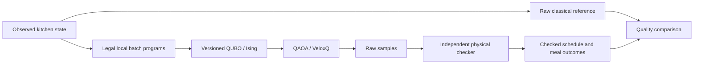

# Project design: Axion Kitchen

Active implementation: `paired-course-contiguous.v3`, encoding
`paired-course-anchor-onehot.v1`. Updated 17 October 2026. Synthetic inputs.
This document specifies the implemented problem and its correctness argument.
The [ambitious specification](docs/CATERING_AMBITIOUS_SPEC.md) is a separate
backlog. Historical factory design is folded at the end.



## 1. Problem, input and output

Choose a continuation of a kitchen's production schedule. Each customer meal
lot needs one main-component lot and one side-component lot, packed before the
same departure. A batch can supply several orders. An unmatched course counts
as discarded food even if it finished on time. One lot is ten portions in the
current fixtures; all formulas below use lots.

Inputs specify menus and allowed yields; prep/cook/pack/clean durations; worker
qualifications and attendance; resource calendars; fixed departures and reveals;
freshness limits; committed batches; observed outages; a previous unstarted plan;
and the declared grid and horizon. Each component-demand group belongs to
exactly one meal and has unit demand. Its partner has a distinct menu and the
same reveal and departure. Each meal has a positive integer priority.

Outputs are selected batch programs plus immutable committed work and recovery
operations. A plan explicitly records operations, worker attendance, component
allocations, surplus disposal, complete-meal handovers and unpaired disposal.
The independent checker reconstructs validity and the objective from these
records. A missed meal is an objective cost, not a hard infeasibility.

The four event cases are S0 normal, S1 urgent meal, S2 idle-cooker withdrawal,
S3 both. They share a committed prefix within each fixture. Replanning uses
observed demand and capacity; the current inputs are deterministic scenarios,
not a statistical robustness study.

An active demand must already be revealed at the snapshot time. Future urgent
groups remain outside the observed snapshot. This profile's outage is on a
declared cooker, with integer grid-aligned 0<=start<=now<end<=horizon; future
planned outages and already completed outages need a different boundary model.
Both snapshot construction and the independent checker reject incompatible
information/outage states rather than silently interpreting them differently.

## 2. Implemented physical semantics

Time is integer minutes on a ten-minute grid. Intervals are half-open, so work
ending at t permits other work to start at t. Every resource operation fits
one declared calendar window and avoids outages. Equipment and identified workers
have unit capacity. Durations and attendance are positive and grid aligned.

For a batch of menu m and yield y, a local program fixes prep start a, cook
start b, packing start c, equipment and workers. With menu durations p, d(y),
k per packed lot, and cleaning duration l, it obeys:

\[
a+p\le b,\qquad b+d(y)\le c,\qquad
\text{clean}=[b+d(y),b+d(y)+l).
\]

Prep, packing and cleaning require full worker attendance. Cooking reserves
its cooker for its full duration but requires the cooking worker only during
the specified initial attendance interval. Cleaning immediately follows cooking
on the same cooker. Packing and cleaning may overlap when their resources differ.

A program allocates r distinct unit component groups with 1 <= r <= y. Packing
is contiguous, one operation per allocated lot, on the single packing line,
with one packing worker for the batch. Position j starts at c+jk and ends at
c+(j+1)k, for j=0,...,r-1. Every allocation starts after reveal, finishes by
departure D, and satisfies 0 <= D-(b+d(y)) <= max_age(m). All new work starts at or after the observed replanning time. Packing
allocations additionally respect each demand's reveal time. Surplus y-r is
discarded at cook completion. A reserved course whose partner is absent is
discarded at departure.

Whole started batches remain fixed, including future phases. This profile
supports withdrawal of idle capacity; it does not interrupt a committed cook.
Every outage requires a qualified worker's ten-minute post-repair clean even
if the cooker remains unused. A conservative preprocessing policy fixes the
earliest clean compatible with committed work. In current S2/S3, repair ends
at 60, C2 waits, W2/C2 clean at 70–80, and new cooking starts no earlier than 80.
This clean is a reserved input task, not an optimized decision variable.

Disabled mechanisms are aggregate ingredients, holding capacity, power, monetary
cost, travel-time constraints, phase-aware WIP and interrupted cooking. Worker
walking in the game is illustrative. R=B in current fixtures because the previous
unstarted plan is empty; those fixtures do not demonstrate independent stability.

## 3. Local programs and the decision register

`catering/options.py` enumerates legal local batch programs: allowed menu/yield,
nonempty unit allocations and packing order, grid starts, eligible equipment
and qualified workers. Each candidate is independently checked with the fixed
boundary before inclusion. This is classical local preprocessing; it does not
solve a compatible whole-kitchen schedule. IDs encode the whole local program.

Let P be the explicitly offered program set, with m programs. A complete-grid
bundle offers every enumerated legal program on that declared profile. A capped
or changing portfolio offers a subset; its optimum need not equal the raw-grid
optimum. The small complete cell and six-customer portfolios are distinct inputs.

Each program's anchor is its lexicographically smallest allocated component-group
ID. Programs with the same anchor form block g. Introduce x_i for every offered
program and one idle bit x_idle(g) per nonempty block:

\[
\sum_{i\in g}x_i=1,\qquad x_i\in\{0,1\}.
\]

N=m+number_of_blocks data bits/qubits are needed in this encoding. Idle bits
are included in N. There are no separate missing-meal or product registers.
The bundle field `size.auxiliary_bits` historically counts these idle bits;
they are data choices, not circuit work ancillas.

**Why grouping preserves compatible subsets.** Any two programs in one block
allocate the same unit anchor demand, so they cannot coexist physically. Every
compatible offered-program subset therefore picks at most one per block. Fill
unused blocks with idle to obtain a unique one-hot bitstring. Conversely, the
program bits of a one-hot bitstring uniquely identify its offered subset.
Grouping itself loses no compatible subset of P. Dropping programs from P can.

Add a cross-block conflict pair whenever two programs duplicate an allocation
or overlap on equipment or worker attendance. Same-block pairs need no separate
conflict term because exactly-one already excludes them. Local candidates were
checked against the fixed boundary. With aggregate capacities disabled, these
pairwise checks cover all remaining cross-program physical interactions.
Thus one-hot plus zero conflict pairs is equivalent to physical feasibility
within the offered domain. This equivalence is checked exhaustively on tiny
instances and independently against decoded records.

## 4. Quadratic objective and exact priority order

For a component group q, let f_q be its fixed coverage (0 or 1) and A_q the
offered programs allocating it. Define coverage C_q=f_q+sum(i in A_q)x_i.
For meal d, write M_d and S_d for its main and side coverage. On feasible
selections both are binary. Let p_d be the meal priority, y_i its batch yield,
r_i its number of allocations, and F the fixed batches. Then:

\[
U=\sum_d p_d(1-M_dS_d),
\]
\[
W=\sum_{b\in F}(y_b-r_b)+\sum_{i\in P}(y_i-r_i)x_i
  +\sum_d(M_d+S_d-2M_dS_d),
\]
\[
B=\sum_{i\in P}x_i,\qquad
R=|T|+\sum_{i\in P}(1-2\mathbf1_{i\in T})x_i,
\]

where T is the set of previous unstarted program IDs. R is exactly the size
of the symmetric difference with that set, including removal of a previous
program not offered now. U counts weighted missed complete-meal lots. W counts
discarded component lots, so the two quantities have different units.

For binary M,S, the paired outcomes are (0,0): missed meal/no orphan,
(1,0) or (0,1): missed meal/one orphan, and (1,1): completed meal/no orphan.
Expanding the linear coverage expressions gives a polynomial of degree at
most two. Any diagonal product reduces using x_i squared=x_i. No product
qubits are required. These expressions need not represent physical waste on
invalid bitstrings; the hard-constraint proof below covers those bitstrings.

An independent accounting identity is useful here: on every feasible plan,
W equals total produced component lots minus twice the number of completed
meal lots. Every completed meal consumes exactly two components; every other
produced component is surplus or unpaired disposal. This also shows that the
loss neither rewards cooking unusable food nor counts reserved food as served.

Let nonnegative integer K_U,K_W,K_B,K_R bound the corresponding costs on all
feasible offered schedules. The default safe bounds are sum of active meal
priorities, total fixed plus offered yields, m, and m+|T|. The optional tighter
bounds replace m by the number of blocks and bound output by fixed yield plus
the maximum yield in each block. They are feasible-domain bounds, not bounds
on invalid selections.

Starting with w_R=1, define each higher weight as one plus the sum of lower
weights times their bounds. Minimize:

\[
C(x)=w_UU+w_WW+w_BB+w_RR.
\]

**Priority proof.** If two feasible schedules first differ at component k,
an improvement is at least one integer unit. Its weighted gain is at least
w_k. The maximum possible adverse change of every lower component together
is at most sum(lower j) w_j K_j, strictly less than w_k. The scalar objective
therefore orders feasible schedules exactly lexicographically by (U,W,B,R).
No exchange rate between missed meals and wasted portions is assumed.

For the complete cell, bounds are (U=2,W=47,B=32,R=32), weights are
(w_U=52272,w_W=1089,w_B=33,w_R=1), and the optimum (0,0,2,2) has C=68.
Weights differ across representations; compare operational tuples across them.

## 5. Hard constraints and ground-state guarantee

Write the expanded objective as C=c0+sum a_i x_i+sum(i<j)b_ij x_i x_j.
Let S=sum|a_i|+sum|b_ij| and choose P=S+1. The compiled energy is:

\[
E(x)=C(x)+P\sum_g\left(\sum_{i\in g}x_i-1\right)^2
            +P\sum_{(i,j)\in\mathcal F}x_ix_j.
\]

For every pair of binary strings, |C(x)-C(y)| <= S, because every linear
or quadratic monomial changes by at most one. Every hard violation incurs an
integer penalty of at least P and every penalty is nonnegative. The compiler
checks that fixed work plus recovery tasks is feasible, so the all-idle
continuation is a zero-penalty witness. An invalid x therefore has
E(x) >= C(x)+P > C(y)=E(y) for every feasible y. Every global ground state is
feasible and minimizes the declared lexicographic objective over P.

This proof includes negative objective coefficients and values off the feasible
set. A heuristic is not guaranteed to find a ground state. Large safe penalties
can cause numerical/conditioning difficulties; changing them requires a new
validated bound and bundle identity. For the cell, P=11141287.

## 6. Ising, quantum method and simulation scope

With z_i=1-2x_i and Pauli Z eigenvalues z_i, the integer export represents 4E:

\[
4E=\left(4c+2\sum_i q_i+\sum_{i<j}Q_{ij}\right)
 +\sum_i\left(-2q_i-\sum_{j\ne i}Q_{ij}\right)z_i
 +\sum_{i<j}Q_{ij}z_iz_j.
\]

Here c,q,Q are the full penalized QUBO coefficients. The exporter
`catering/qubo.py:ising` emits this convention. VeloxQ's s=2x-1 uses the
opposite linear sign; its adapter checks its own exact scaled convention.
Integer input transport alone does not establish backend internal precision.

The retained quantum method uses a product of one-hot block states, biased
toward idle or the current quantum incumbent with exploration 0.15. Sequential
XY gates exp[-i beta(XX+YY)/2] act on adjacent block qubits, including the ring
closing edge for blocks larger than two. They mix |10> and |01> and preserve
one excitation per block. The one-hot penalty vanishes in this invariant
sector; cross-block conflict penalties still matter.

Each multi-angle layer applies a phase for the objective divided by w_U,
a separate phase for the number of conflict violations, then XY mixing.
Parameter candidates are seeded random search, selected by exact simulator
CVaR at alpha 0.1 over the literal E distribution. Final outcomes are sampled
and independently checked without repair. This is exact-sector simulation and
exact-CVaR optimization, not shot-noisy training or a physical-QPU result.

The simulator explicitly builds all one-hot-sector energies. The complete
cell has block sizes 5,11,19, hence 1045 states, of which 59 are physically feasible.
Its 35 data qubits do not imply a hard classical instance. Small full-Hilbert
and native/routed Qiskit checks validate circuit/sector equivalence, including
layout permutation. Larger routing audits use a synthetic topology, not an
actual calibrated IBM target. No hardware readiness or speedup follows.

Dynamic portfolios retain the quantum-sampled incumbent and propose additional
legal local choices. Only a strictly better checked sample replaces it; quality
is monotone, but global convergence is not guaranteed. No CP solution supplies
the quantum incumbent. Per-step controls share that incumbent, so they are not
independent end-to-end controller comparisons.

## 7. Independent correctness and solution-quality evidence

`check.py` imports no compiler or conflict graph. It reconstructs operation,
calendar, worker, outage, freshness, allocation and material checks from raw
records. `paired_meals.py:check_service` reconstructs complete handovers and
unpaired disposal. Shared schemas/recipe data are intentional; this is not a
fully independent second implementation of every domain helper.

The raw CP reference (`native_slots.py`) chooses batches, resources, workers,
times and allocations without program enumeration or the QUBO conflict graph.
Every active batch allocates at least one residual lot, so residual demand is
an exact upper bound on the number of batch slots. The offered CP reference
(`meal_reference.py`) instead reads the offered conflict constraints and
minimizes the identical quadratic objective on the zero-penalty set. It checks
decoded records and literal energy. Under the penalty proof, this solves the
same ground problem, but it is not the independent raw reference.

Let D_raw be the full declared raw domain and P its offered subdomain. For a
checked returned schedule z, lexicographic optima obey C_raw* <= C_P* <= C(z).
The first gap is representation loss and the second is search loss. Values
must be tuples or one common scalarization; subtracting raw energies from
different coefficient versions is invalid. OPTIMAL is a certificate within
the stated model. FEASIBLE is an incumbent; UNKNOWN has no returned certificate.
An offered incumbent matching a certified raw optimum also certifies its
operational tuple, even when the offered solver timed out without that proof.

Frozen evidence includes a complete 35-qubit cell, four six-customer restricted
cases, eight changing-portfolio QAOA runs, and 512/1024/2048-variable same-model
VeloxQ scale inputs with their receipts and references. The separate
[quality audit](docs/CATERING_QUALITY.md) gives exact statuses, tuples and
remaining limitations. The small-cell controls also attain its optimum.
Larger quantum pilots and first VeloxQ settings do not establish superiority.

## 8. Reproduce and review

See [catering/README.md](catering/README.md) for pinned environments and commands,
[solver contract](docs/CATERING_SOLVER_CONTRACT.md) for bit/result conventions,
and [presentation plan](docs/CATERING_PRESENTATION.md) for the final demonstration.
Retained evidence is immutable: fresh verification goes into a new directory.
Hash checks, literal-energy/metric checks, tiny exhaustive tests, exact-sector
equivalence and offline adapter tests support the mathematical arguments.

Before submission, select one primary quantum result and freeze its source and
bundle hashes. Rehearse an actual executable launch, synchronize spoken claims,
design, code and results, and review all required Stage 1 artifacts. Keep GitHub
private until the agreed final submission step. No service use, training,
public release or final video is implied by this design document.

## Archived manufacturing design

The following is preserved decision history from the earlier factory direction.
It does not define the active catering model or its current execution status.

<details>
<summary>Earlier factory design and evidence</summary>

## Current manufacturing centerpiece — 17 October update

The main demonstration uses complete 16-operation recipes (32–128 operations). Replacing heat capacity changes certified full-model weighted tardiness from 45 to 0; the original 781-bit operation pool stays at 45. Nested deterministic enrichment restores recovery with 2,078 bits, versus 2,499 for complete optimization. A distinct exact deadline-decision QUBO uses 818 bits and 33,817 couplers for the replacement query. Its zero-energy guarantee concerns feasibility, not the original soft-objective landscape.

The integrated [recipe bridge](docs/STAGE2_RECIPE_BRIDGE.md) keeps all 32 operations in eight component groups, recombining independently constructed complete routes. Its 18/28/36 logical-qubit models have 512/26,244/262,144 one-hot sector states. QAOA and sector annealing each produce 18/18 physically valid same-pool optimal schedules across two capacity cases, three caps and three seeds. The constructor already supplies an optimal incumbent; exact sector construction reveals minima classically. This is quantum integration and a sampling comparison, without advantage or scalable quantum-simulation claims. An independent circuit audit checks emitted QASM; the six 18-qubit circuits receive full-Hilbert probability checks, while larger circuits receive resource audits.

[Feature ablations](docs/STAGE2_REALISM_FRONTIER.md) fix horizon/grid and count unary/support bits, couplers and coefficient scale. All six ablations have exact native and restricted references. Larger 64/128-operation native runs remain UNKNOWN with checked bounds. [Economics](docs/STAGE2_CAPACITY_ECONOMICS.md) computes an exact rational ledger and 135 sensitivities for four checked saved plans under synthetic prices. It values schedules selected for deadline priority; it is not a minimum-money weekly optimizer. The studio exposes these assumptions and purchase/event-fee thresholds.

See [the evidence map](docs/STAGE2_MANUFACTURING_STUDY.md), [combined design](docs/STAGE2_COMBINED_DIRECTION.md), and [acceptance record](docs/STAGE2_MERIT_ACCEPTANCE.md). Local studio: http://127.0.0.1:4192/manufacturing/. Four new cold offline packets support the future integrated VeloxQ backend comparison, including matched original-objective penalties. VeloxQ is part of this same Stage2 extension. No VeloxQ execution or physical QPU call; private-remote sync and automatic site deployment are authorized, while public-source release/submission remain pending. Earlier sections below retain their explicitly smaller scopes.

Status: agreed non-VeloxQ technical merit scope complete, 17 October 2026; all 14 core requirements passed. See [current status](docs/STAGE2_STATUS.md) for evidence and the remaining VeloxQ, synchronized video, rehearsal and release duties. The complete-recipe bridge is integrated; the residual-cell study below retains its separate scope. No VeloxQ or physical ODRA5 execution is claimed.

## Main-model mathematical specification

[Mathematics of the complete-recipe manufacturing model](docs/STAGE2_MANUFACTURING_MATH.md)
is the readable formulation reference for the main32-operation entry. It defines
raw assignment domains, processing/attendance calendars, metric setup and worker
travel assumptions, material precedence, the completion register, full quadratic
polynomial and coefficient conventions. It proves the integer objective hierarchy
and represented-witness penalty bound, and distinguishes exact support pruning,
lossy grid/pool restrictions, the hard-deadline query and the component-route
quantum bridge. Owning code, exhaustive tests and frozen evidence are linked.

## Smaller quantum validation design

The smaller validation cell’s numerical definition, complete equations, reduction proof,
source-sealed experiment protocol, results, scopes and rubric map are in
[STAGE2_ENTRY.md](docs/STAGE2_ENTRY.md). The decision is how to schedule remaining
pump machining, a material-join assembly and inspections after capacity changes,
including shared workers, cross-training, alternate machines, calendars and due
dates. This stays within manufacturing. All data are explicitly synthetic.

Use the full two-hall factory below to explain the industrial system; use the
complete residual-cell QUBO to demonstrate the quantum formulation on a bounded,
explicit model. The residual cell is not a trace-extracted state or a lossless
full-factory reduction. Its independent native CP reference uses the same input
and objective. No CP schedule or pool of reference answers initializes QAOA.

`entry_core.py` defines instances; `window_qubo.py` compiles assignment and
completion bits; `assignment_qaoa.py` preserves every one-hot group through W
preparation and ordered XY mixing. CVaR .25 / p=2 is selected on TRAIN seeds only.
All 60 TEST quantum outputs are valid optimal actual schedules; 57 measured
bitstrings attain exact QUBO minima. Three completion registers exceed actual
completion by 30, and both values are disclosed. Annealing attains all 60 exact
minima too. The simulator classically enumerates the sector energy table; no
speedup or full-factory optimum is claimed.

`entry_demo.py` serves a loopback-only fresh-run action and `presentation/entry/`
shows retained evidence and counterfactual schedules. The static build contains
no Python service or credentials. `entry_velox_offline.py` has no submit option;
its nine SDK-format packets use exact integer Hamiltonian rescaling after an
audit detected float32 energy loss. Backend acceptance and internal precision
remain unverified. Source snapshots, counts, QASM, references and manifests are
retained; `scripts/verify-stage2-entry.py` rechecks claims and every TEST plan.

## Official optimization problem

Each job visits the common machine route, with the fixed processing durations in `instances/`. Each operation runs once, machine processing intervals do not overlap, and a predecessor completes before a successor starts. Minimize the latest completion time. Baseline outputs use nonnegative integer hours and `end = start + duration`.

Instance A requires its QUBO to be solved using a quantum algorithm on hardware or a simulator. Instance B requires its QUBO to be solved using a QUBO solver. Both selected outputs use actual local QAOA simulation of the compact order QUBOs, with exact makespans 4/8 hours; see [STAGE1_COMPACT.md](docs/STAGE1_COMPACT.md). The earlier fixed-horizon time-indexed QUBO, weights, window bounds, feasibility argument and classical reference remain comparison evidence in [STAGE1_OFFLINE.md](docs/STAGE1_OFFLINE.md) and [STAGE1_REFINEMENT.md](docs/STAGE1_REFINEMENT.md). Neither VeloxQ nor ODRA5 executed; both remain on user hold.

## Implemented display model

The browser reads a versioned `axion-replay.v1` object:

```json
{
  "schema": "axion-replay.v1",
  "unit": "hours",
  "provenance": {
    "kind": "illustration",
    "method": "Manual transcription",
    "label": "Organizer slide",
    "description": "An illustration, not a solver run",
    "source": "Opening presentation",
    "jobId": null
  },
  "machines": [{ "id": "T", "name": "Turning" }],
  "jobs": [{ "id": "Z1", "color": "#648da3", "operations": [{ "machine": "T", "duration": 2 }] }],
  "schedule": [{ "job": "Z1", "machine": "T", "start": 0, "end": 2 }]
}
```

This schematic shows field shapes, not a complete loadable instance: the current viewer accepts two or three machines, one to twelve jobs, and a common route visiting each displayed machine once. `kind` is `illustration`, `imported`, or `solver`. Metadata is displayed as supplied, never treated as authenticated execution evidence. Optional backend, timestamp, job id, and declared makespan may accompany a replay.

The official schedule adapter chooses the known instance from `instance_2x2`/`instance_3x3`, attaches the authoritative processing durations, and preserves the declared method as unverified imported metadata. It rejects noninteger baseline times. Export produces a display replay, not a newly certified official solver output.

## Validation and replay semantics

- Structural parsing rejects unknown job/machine references, duplicate model ids, invalid colors, nonfinite/negative intervals, and unsupported routes.
- Coverage compares each required job-machine operation with the full schedule and rejects missing/duplicate operations.
- Duration compares every interval length against the input duration.
- Capacity compares all operation pairs sharing a machine.
- Precedence compares each job's adjacent operations.
- If provided, declared makespan must equal the maximum operation end.
- Intervals are half-open. At a boundary the previous machine is released and the successor can start immediately.
- Completed count requires all expected operations. Missing operations cannot silently produce a completed part.

This establishes schedule feasibility under the baseline model. It does not prove global optimality or establish that a named solver ran.

## Factory interface and Stage 1 manual

The factory world fills the viewport. Lunar Assembly is the fixed appearance, with cool deck plates, blue steel and ceramic controls shared by the manual and error page. Alternatives are archived outside the shipped viewer; there is no runtime style selector. Lunar instrument-panel navigation switches between the live world and the control desk, whose Timeline and Validation menus preserve replay time and part selection. Playback, part inventory and completion metrics live in the bottom HUD. Keyboard controls, native fullscreen with fallback, reduced motion and responsive layouts are supported.

`/problem-explanation` is an independent six-chapter manual in the same visual system, reachable from the top navigation and footer. It covers official inputs/rules, schedule calculation and optimality, fixed-horizon QUBO penalties, one-hot/domain-wall encodings, current selected local solver results, and complexity. Job-order, one-hot, compact-bit and scaling controls use deterministic teaching models. Their diagrams are labeled as illustrations rather than new solver runs. `evidence.js` summarizes the selected actual runs and is tested against the selection manifest. Directory routes are served by `scripts/serve.mjs`; the static build copies the manual into `dist/problem-explanation/`.

## Architecture and planned integration

`presentation/model.js` is a DOM-free parser/checker. `data.js` contains explicitly illustrative records. `lunar.js` supplies fixed scene materials/scenery and removes obsolete comparison query parameters; `lunar.css` shares the Lunar material palette across pages. `scene.js` creates original pixel art and positions parts from replay state. `app.js` synchronizes the views and handles local imports. `scripts/serve.mjs` serves only the presentation folder on loopback.

The solver pipeline saves actual samples, model coefficients, parameters, source/model/instance hashes, versions, run metadata and decoded official schedules, plus derived replays. Secrets remain in the execution environment; the browser needs no solver token. Classical references remain separate from returned solver samples. Current selection is recorded in `output/stage1-selected.json`, pointing to `output/stage1-compact-ready/`; previous runs remain retained.

One-hot sizes are 8 variables at H=4 for A and 39 at H=8 for B; domain-wall sizes are 4 and 30. All 512,000 allowed operation-start combinations for B agree with the independent checker in both encodings; invalid-wall correctness uses an explicit penalty bound and exhaustive small-model tests. These earlier methods remain comparison evidence. The selected `solver/sequence.py` models preserve every common job order using 1 bit for A and 3 bits for B: `E_A=4+a`, `E_B=9-a+3b-c-2ab+3ac-3bc`. Each valid state's energy is its earliest-start makespan; cyclic B states cost 12/10, above valid costs 8/9. Both are solved by QAOA: A p=1/shared-X/one restart, B p=2/local-X/eight restarts, with 4,096/4,096 optimal measurements each. Twenty fresh seeds gave 81,920/81,920 optimal shots per instance. All n! permutation costs are computed classically to construct these tiny QUBOs; this reveals the permutation optimum before quantum execution. The representation excludes extra idle time and independent machine orders, with zero loss to the full independent reference on the official instances. No scalable compilation or quantum advantage is claimed. Three bits attain the information minimum only for distinct representation of all six common orders; no unrestricted minimum is claimed. See `docs/STAGE1_COMPACT.md` for coefficients, proof, matched comparisons and evidence. Exact independent optima are 4 h and 8 h. SDK serialization/result parsing is tested locally; remote performance is unknown. See `docs/STAGE1_OFFLINE.md` for formulas, settings, proof and limitations, and `docs/ODRA5.md` for native compilation and hardware access.

## Stage 2 implemented factory and research artifacts

`docs/STAGE2_ENVIRONMENT.md` specifies the working ambitious factory proposal;
`docs/STAGE2_IDEATION.md` records alternatives, design iterations and critiques.
The user directed us to begin at high complexity and simplify only following
demonstrated obstacles. The 24-order, 15-machine model joins component production,
transport, assembly, energy, people/tooling, quality and uncertain recovery.

`instances/stage2/metaltech_pressure.json` supplies design parameters;
`stage2/spec.py` expands complete numerical instances. `stage2/engine.py` executes
the physical factory and `stage2/check.py` independently replays resource use,
movement, genealogy, quality, energy and revealed events. The original
`scripts/stage2_blueprint.py` remains a structural design tool. Its historical
missing-table list does not describe the implemented minute-resolution profile.

The exact finite-state encoding remains conceptual and potentially enormous.
The implemented quantum experiment selects compatible ready starts from a
restricted boundary-frozen pool, with all slack variables counted. Exact local
equivalence does not establish full-policy optimality. Matched classical controls,
learned policies, scenario lookahead, independent replay and scoped deterministic
CP references provide separate evidence. Physical quantum hardware and VeloxQ
are not used in the current research scope. The versioned trace contract is
`stage2/TRACE_CONTRACT.md`; the separate viewer is `presentation/stage2/`.

See `stage2/README.md`, `docs/STAGE2_METHOD_AUDIT.md` and
`docs/STAGE2_EXPERIMENT_LOG.md` for actual mechanisms, limitations, results and
precomputation costs. Reserved final tapes remain distinct from development.

The frozen campaign is complete: 23,552 valid executions across 74 method/context
groups, with 41 declared comparisons. The later [solution-quality supplement](docs/SOLUTION_QUALITY.md)
quantifies realized-primary gap intervals using unchanged final outcomes and
stronger offline necessary-quality bounds. Exact deterministic reference makespans
and full-factory missing-order certificates have separate scopes; neither implies
optimal full-factory deadline debt/cost or a quantum advantage.


</details>
