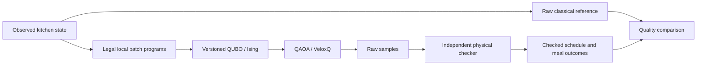

# Project design: Axion Kitchen

Active implementation: `paired-course-contiguous.v3`, encoding
`paired-course-anchor-onehot.v1`. Updated 17 October 2026. Synthetic inputs.
This document specifies the implemented problem and its correctness argument.
The [ambitious specification](docs/archive/planning/CATERING_AMBITIOUS_SPEC.md) is a separate
backlog. Historical factory design is folded at the end.



## 1. Problem, input and output

Choose a continuation of a kitchen's production schedule. Each customer meal
lot needs one main-component lot and one side-component lot, packed before the
same departure. A batch can supply several orders. An unmatched course counts
as discarded food even if it finished on time. One lot is ten portions in the
current fixtures; all formulas below use lots.

Inputs specify menus and allowed yields; prep/cook/pack/clean durations; worker
qualifications and attendance; resource calendars; fixed departures and reveals;
freshness limits; committed batches; observed outages; a previous unstarted plan;
and the declared grid and horizon. Each component-demand group belongs to
exactly one meal and has unit demand. Its partner has a distinct menu and the
same reveal and departure. Each meal has a positive integer priority.

Outputs are selected batch programs plus immutable committed work and recovery
operations. A plan explicitly records operations, worker attendance, component
allocations, surplus disposal, complete-meal handovers and unpaired disposal.
The independent checker reconstructs validity and the objective from these
records. A missed meal is an objective cost, not a hard infeasibility.

The four event cases are S0 normal, S1 urgent meal, S2 idle-cooker withdrawal,
S3 both. They share a committed prefix within each fixture. Replanning uses
observed demand and capacity; the current inputs are deterministic scenarios,
not a statistical robustness study.

An active demand must already be revealed at the snapshot time. Future urgent
groups remain outside the observed snapshot. This profile's outage is on a
declared cooker, with integer grid-aligned 0<=start<=now<end<=horizon; future
planned outages and already completed outages need a different boundary model.
Both snapshot construction and the independent checker reject incompatible
information/outage states rather than silently interpreting them differently.

## 2. Implemented physical semantics

Time is integer minutes on a ten-minute grid. Intervals are half-open, so work
ending at t permits other work to start at t. Every resource operation fits
one declared calendar window and avoids outages. Equipment and identified workers
have unit capacity. Durations and attendance are positive and grid aligned.

For a batch of menu m and yield y, a local program fixes prep start a, cook
start b, packing start c, equipment and workers. With menu durations p, d(y),
k per packed lot, and cleaning duration l, it obeys:

$$
a+p\le b,\qquad b+d(y)\le c,\qquad
\text{clean}=[b+d(y),b+d(y)+l).
$$

Prep, packing and cleaning require full worker attendance. Cooking reserves
its cooker for its full duration but requires the cooking worker only during
the specified initial attendance interval. Cleaning immediately follows cooking
on the same cooker. Packing and cleaning may overlap when their resources differ.

A program allocates r distinct unit component groups with 1 <= r <= y. Packing
is contiguous, one operation per allocated lot, on the single packing line,
with one packing worker for the batch. Position j starts at c+jk and ends at
c+(j+1)k, for j=0,...,r-1. Every allocation starts after reveal, finishes by
departure D, and satisfies 0 <= D-(b+d(y)) <= max_age(m). All new work starts at or after the observed replanning time. Packing
allocations additionally respect each demand's reveal time. Surplus y-r is
discarded at cook completion. A reserved course whose partner is absent is
discarded at departure.

Whole started batches remain fixed, including future phases. This profile
supports withdrawal of idle capacity; it does not interrupt a committed cook.
Every outage requires a qualified worker's ten-minute post-repair clean even
if the cooker remains unused. A conservative preprocessing policy fixes the
earliest clean compatible with committed work. In current S2/S3, repair ends
at 60, C2 waits, W2/C2 clean at 70–80, and new cooking starts no earlier than 80.
This clean is a reserved input task, not an optimized decision variable.

Disabled mechanisms are aggregate ingredients, holding capacity, power, monetary
cost, travel-time constraints, phase-aware WIP and interrupted cooking. Worker
walking in the game is illustrative. R=B in current fixtures because the previous
unstarted plan is empty; those fixtures do not demonstrate independent stability.

## 3. Local programs and the decision register

`catering/options.py` enumerates legal local batch programs: allowed menu/yield,
nonempty unit allocations and packing order, grid starts, eligible equipment
and qualified workers. Each candidate is independently checked with the fixed
boundary before inclusion. This is classical local preprocessing; it does not
solve a compatible whole-kitchen schedule. IDs encode the whole local program.

Let P be the explicitly offered program set, with m programs. A complete-grid
bundle offers every enumerated legal program on that declared profile. A capped
or changing portfolio offers a subset; its optimum need not equal the raw-grid
optimum. The small complete cell and six-customer portfolios are distinct inputs.

Each program's anchor is its lexicographically smallest allocated component-group
ID. Programs with the same anchor form block g. Introduce x_i for every offered
program and one idle bit x_idle(g) per nonempty block:

$$
\sum_{i\in g}x_i=1,\qquad x_i\in\{0,1\}.
$$

N=m+number_of_blocks data bits/qubits are needed in this encoding. Idle bits
are included in N. There are no separate missing-meal or product registers.
The bundle field `size.auxiliary_bits` historically counts these idle bits;
they are data choices, not circuit work ancillas.

**Why grouping preserves compatible subsets.** Any two programs in one block
allocate the same unit anchor demand, so they cannot coexist physically. Every
compatible offered-program subset therefore picks at most one per block. Fill
unused blocks with idle to obtain a unique one-hot bitstring. Conversely, the
program bits of a one-hot bitstring uniquely identify its offered subset.
Grouping itself loses no compatible subset of P. Dropping programs from P can.

Add a cross-block conflict pair whenever two programs duplicate an allocation
or overlap on equipment or worker attendance. Same-block pairs need no separate
conflict term because exactly-one already excludes them. Local candidates were
checked against the fixed boundary. With aggregate capacities disabled, these
pairwise checks cover all remaining cross-program physical interactions.
Thus one-hot plus zero conflict pairs is equivalent to physical feasibility
within the offered domain. This equivalence is checked exhaustively on tiny
instances and independently against decoded records.

## 4. Quadratic objective and exact priority order

For a component group q, let f_q be its fixed coverage (0 or 1) and A_q the
offered programs allocating it. Define coverage C_q=f_q+sum(i in A_q)x_i.
For meal d, write M_d and S_d for its main and side coverage. On feasible
selections both are binary. Let p_d be the meal priority, y_i its batch yield,
r_i its number of allocations, and F the fixed batches. Then:

$$
U=\sum_d p_d(1-M_dS_d),
$$

$$
W=\sum_{b\in F}(y_b-r_b)+\sum_{i\in P}(y_i-r_i)x_i
  +\sum_d(M_d+S_d-2M_dS_d),
$$

$$
B=\sum_{i\in P}x_i,\qquad
R=|T|+\sum_{i\in P}(1-2\mathbf1_{i\in T})x_i,
$$

where T is the set of previous unstarted program IDs. R is exactly the size
of the symmetric difference with that set, including removal of a previous
program not offered now. U counts weighted missed complete-meal lots. W counts
discarded component lots, so the two quantities have different units.

For binary M,S, the paired outcomes are (0,0): missed meal/no orphan,
(1,0) or (0,1): missed meal/one orphan, and (1,1): completed meal/no orphan.
Expanding the linear coverage expressions gives a polynomial of degree at
most two. Any diagonal product reduces using x_i squared=x_i. No product
qubits are required. These expressions need not represent physical waste on
invalid bitstrings; the hard-constraint proof below covers those bitstrings.

An independent accounting identity is useful here: on every feasible plan,
W equals total produced component lots minus twice the number of completed
meal lots. Every completed meal consumes exactly two components; every other
produced component is surplus or unpaired disposal. This also shows that the
loss neither rewards cooking unusable food nor counts reserved food as served.

Let nonnegative integer K_U,K_W,K_B,K_R bound the corresponding costs on all
feasible offered schedules. The default safe bounds are sum of active meal
priorities, total fixed plus offered yields, m, and m+|T|. The optional tighter
bounds replace m by the number of blocks and bound output by fixed yield plus
the maximum yield in each block. They are feasible-domain bounds, not bounds
on invalid selections.

Starting with w_R=1, define each higher weight as one plus the sum of lower
weights times their bounds. Minimize:

$$
C(x)=w_UU+w_WW+w_BB+w_RR.
$$

**Priority proof.** If two feasible schedules first differ at component k,
an improvement is at least one integer unit. Its weighted gain is at least
w_k. The maximum possible adverse change of every lower component together
is at most sum(lower j) w_j K_j, strictly less than w_k. The scalar objective
therefore orders feasible schedules exactly lexicographically by (U,W,B,R).
No exchange rate between missed meals and wasted portions is assumed.

For the complete cell, bounds are (U=2,W=47,B=32,R=32), weights are
(w_U=52272,w_W=1089,w_B=33,w_R=1), and the optimum (0,0,2,2) has C=68.
Weights differ across representations; compare operational tuples across them.

## 5. Hard constraints and ground-state guarantee

Write the expanded objective as C=c0+sum a_i x_i+sum(i<j)b_ij x_i x_j.
Let S=sum|a_i|+sum|b_ij| and choose P=S+1. The compiled energy is:

$$
E(x)=C(x)+P\sum_g\left(\sum_{i\in g}x_i-1\right)^2
            +P\sum_{(i,j)\in\mathcal F}x_ix_j.
$$

For every pair of binary strings, |C(x)-C(y)| <= S, because every linear
or quadratic monomial changes by at most one. Every hard violation incurs an
integer penalty of at least P and every penalty is nonnegative. The compiler
checks that fixed work plus recovery tasks is feasible, so the all-idle
continuation is a zero-penalty witness. An invalid x therefore has
E(x) >= C(x)+P > C(y)=E(y) for every feasible y. Every global ground state is
feasible and minimizes the declared lexicographic objective over P.

This proof includes negative objective coefficients and values off the feasible
set. A heuristic is not guaranteed to find a ground state. Large safe penalties
can cause numerical/conditioning difficulties; changing them requires a new
validated bound and bundle identity. For the cell, P=11141287.

## 5.1. The price of realism

The smallest submitted baseline-B formulation uses **3 binary order variables**.
The official comparison is **72** time-indexed variables at H=8; chain-window
pruning gives **39**. Our three bits represent the six common job permutations,
with an earliest-start decoder and factorial classical cost tabulation. They do
not preserve every timed schedule. The optimum on official B is still 8h.
See [the baseline derivation](docs/STAGE1_COMPACT.md).

For the extension, distinguish a new decision from a new restriction on existing
choices. A program already specifies quantity, allocation order, equipment,
crew and all phase times. Its constraints may remove choices or add conflicts;
new quantities/resources can increase the program count K. The register is
K+G, including one idle bit for each of the G nonempty anchor blocks.

A concrete unpruned time-indexed comparator for the **same complete cell** is:

1. Use K_m optional batch slots per menu, bounded by residual component demand.
2. A configuration alpha selects yield, a nonempty ordered allocation, equipment
   and qualified crew, without times. Introduce one activation bit per slot/configuration.
3. Add prep, cook and pack start registers over T grid starts. Cleaning immediately
   follows cooking and is included in its known occupancy profile. Impose
   sum_t x_phase,t = activation, at most one configuration per slot, and the
   timing/resource/allocation exclusions. These are unary or quadratic constraints.
4. Component coverage is linear in activations, so the paired service/waste
   objective is quadratic. In this cell the previous unstarted plan is empty.

Thus N_TI = sum_m K_m |A_m| (1+3|T|). For distinct unit-demand groups,
|A_m| counts all equipment/qualified-crew choices times all yield/nonempty
allocation-order choices. Here |T|=14; B has K=1, |A|=2 and C has K=2, |A|=12.
The unpruned total is 26 activation bits + 1092 start bits = **1118**.
This is an explicitly specified analytical comparator, not a compiled or timed
reference solver, a minimum or a claim of speedup. Unary pruning would reduce it.

| Cell choices | Analytic unpruned time indexing | Complete program register |
|---|---:|---:|
| C1 only | 559 | 8 programs + 2 idle = 10 |
| Yield1 only | 430 | 18 programs + 2 idle = 20 |
| No shared batches | 774 | 30 programs + 3 idle = 33 |
| Full declared cell | 1118 | 32 programs + 3 idle = 35 |

Each restricted row independently filters the full cell; rows are not additive.
Adding the second cooker costs 559 comparator bits versus 25 program bits;
allowing yield 2 costs 688 versus 15; allowing sharing costs 344 versus 2.
The chosen-register counts are read directly from the complete retained domain.
Compiling those locally valid programs is classical preprocessing, not free work.

| Added constraint or objective | Extra comparator registers | Extra program registers |
|---|---|---|
| Phase precedence and immediate cooker cleaning | 0; forbid incompatible start pairs | 0; reject invalid local programs |
| Fixed departures and freshness | 0; remove illegal starts or time pairs | 0; remove illegal programs |
| Calendars, observed outages and fixed started work | 0; substitute known occupancy and remove clashes | 0; prune programs against the fixed state |
| Mandatory post-repair clean at the declared fixed time | 0; known worker/cooker occupancy | 0; known worker/cooker occupancy |
| Unit-capacity equipment and attended-worker clashes | 0; pair exclusions between timed choices | 0; pair exclusions between programs |
| Paired complete service and unpaired waste | 0; quadratic activation coverage | 0; quadratic program coverage |
| Stability in these empty-prior fixtures | 0; R=B | 0; R=B |

Zero extra registers does not mean zero extra coefficients or unchanged total
bits. At the same offered register, the paired objective has 200 quadratic pairs:
182 reuse hard edges and 18 add distinct edges. The full cell has 236 one-hot
pairs, 266 cross-block conflicts and 18 extra objective edges, totaling 520 couplers.
Conflict causes overlap and must not be summed. Nonempty-prior exact-timed-match
terms would require additional accounting in the analytical comparator.

Reproduce these counts without solving or changing a model:

```sh
python scripts/report-catering-realism.py --output /tmp/NEW-REALISM-COUNTS.json
```

The checked report is [catering-realism-cost-v1](output/catering-realism-cost-v1/report.json).

## 6. Ising, quantum method and simulation scope

With z_i=1-2x_i and Pauli Z eigenvalues z_i, the integer export represents 4E:

$$
4E=\left(4c+2\sum_i q_i+\sum_{i<j}Q_{ij}\right)
 +\sum_i\left(-2q_i-\sum_{j\ne i}Q_{ij}\right)z_i
 +\sum_{i<j}Q_{ij}z_iz_j.
$$

Here c,q,Q are the full penalized QUBO coefficients. The exporter
`catering/qubo.py:ising` emits this convention. VeloxQ's s=2x-1 uses the
opposite linear sign; its adapter checks its own exact scaled convention.
Integer input transport alone does not establish backend internal precision.

The primary retained quantum method uses a product of one-hot block states, biased
toward idle or the current quantum incumbent with exploration 0.15. Sequential
XY gates exp[-i beta(XX+YY)/2] act on adjacent block qubits, including the ring
closing edge for blocks larger than two. They mix |10> and |01> and preserve
one excitation per block. The one-hot penalty vanishes in this invariant
sector; cross-block conflict penalties still matter.

Each multi-angle layer applies a phase for the objective divided by w_U,
a separate phase for the number of conflict violations, then XY mixing.
The selected depth-three setup uses layerwise COBYLA with exact simulator
CVaR at alpha 0.1 over the literal E distribution. The configuration was selected
on the cell/S0/S1, then frozen before S2/S3; angles are still optimized per
instance. The 400-run campaign includes seeded random-angle and initializer
controls at declared budgets. The earlier changing-portfolio pilot used random
parameter search and remains development evidence. Final outcomes are sampled
and independently checked without repair. This is exact-sector simulation and
exact-CVaR optimization, not shot-noisy training or a physical-QPU result.

The simulator explicitly builds all one-hot-sector energies. The complete
cell has block sizes 5,11,19, hence 1045 states, of which 59 are physically feasible.
Its 35 data qubits do not imply a hard classical instance. Small full-Hilbert
and native/routed Qiskit checks validate circuit/sector equivalence, including
layout permutation. Larger routing audits use a synthetic topology, not an
actual calibrated IBM target. No hardware readiness or speedup follows.

Dynamic portfolios retain the quantum-sampled incumbent and propose additional
legal local choices. Only a strictly better checked sample replaces it; quality
is monotone, but global convergence is not guaranteed. No CP solution supplies
the quantum incumbent. Per-step controls share that incumbent, so they are not
independent end-to-end controller comparisons.

## 7. Independent correctness and solution-quality evidence

`check.py` imports no compiler or conflict graph. It reconstructs operation,
calendar, worker, outage, freshness, allocation and material checks from raw
records. `paired_meals.py:check_service` reconstructs complete handovers and
unpaired disposal. Shared schemas/recipe data are intentional; this is not a
fully independent second implementation of every domain helper.

The raw CP reference (`native_slots.py`) chooses batches, resources, workers,
times and allocations without program enumeration or the QUBO conflict graph.
Every active batch allocates at least one residual lot, so residual demand is
an exact upper bound on the number of batch slots. The offered CP reference
(`meal_reference.py`) instead reads the offered conflict constraints and
minimizes the identical quadratic objective on the zero-penalty set. It checks
decoded records and literal energy. Under the penalty proof, this solves the
same ground problem, but it is not the independent raw reference.

Let D_raw be the full declared raw domain and P its offered subdomain. For a
checked returned schedule z, lexicographic optima obey C_raw* <= C_P* <= C(z).
The first gap is representation loss and the second is search loss. Values
must be tuples or one common scalarization; subtracting raw energies from
different coefficient versions is invalid. OPTIMAL is a certificate within
the stated model. FEASIBLE is an incumbent; UNKNOWN has no returned certificate.
An offered incumbent matching a certified raw optimum also certifies its
operational tuple, even when the offered solver timed out without that proof.

Frozen evidence includes a complete 35-qubit cell, four six-customer restricted
cases, the 400-run trained QAOA campaign, five independently checked VQE exports,
eight earlier changing-portfolio QAOA runs, and 512/1024/2048-source-variable
same-model VeloxQ inputs with receipts and references. The no-idle representation
uses 486/998/2022 actual solver variables and preserves feasible objectives and
optima. At equal 20,000 steps on the 512-source-bit tier, validity improves from
17 to 512 of 512 returns and best missed-meal lots from 13 to 9. Other methods
still find better schedules. The separate
[quality audit](docs/CATERING_QUALITY.md) gives exact statuses, tuples and
remaining limitations. The small-cell controls also attain its optimum.
The trained QAOA configuration improves per-shot optimum probability against
its random-angle control on the offered pools. VQE reports higher probabilities
with different work budgets; these are not matched-budget solver rankings.

## 8. Reproduce and review

See [catering/README.md](catering/README.md) for pinned environments and commands,
[solver contract](docs/CATERING_SOLVER_CONTRACT.md) for bit/result conventions,
and [presentation plan](docs/CATERING_PRESENTATION.md) for the final demonstration.
Retained evidence is immutable: fresh verification goes into a new directory.
Hash checks, literal-energy/metric checks, tiny exhaustive tests, exact-sector
equivalence and offline adapter tests support the mathematical arguments.

The primary live result is the frozen p=3 cell QAOA circuit; VQE is the additional
ansatz comparison and VeloxQ the larger same-model representation study. Before
submission, freeze the final release commit. Rehearse an actual executable launch, synchronize spoken claims,
design, code and results, and review all required Stage 1 artifacts. Keep GitHub
private until the agreed final submission step. No service use, training,
public release or final video is implied by this design document.

## Archived manufacturing design

[Preserved in the historical archive](docs/archive/2026-10-17/FACTORY_PACKAGE_BEFORE_RELEASE.md#design). It is not the active catering package.
