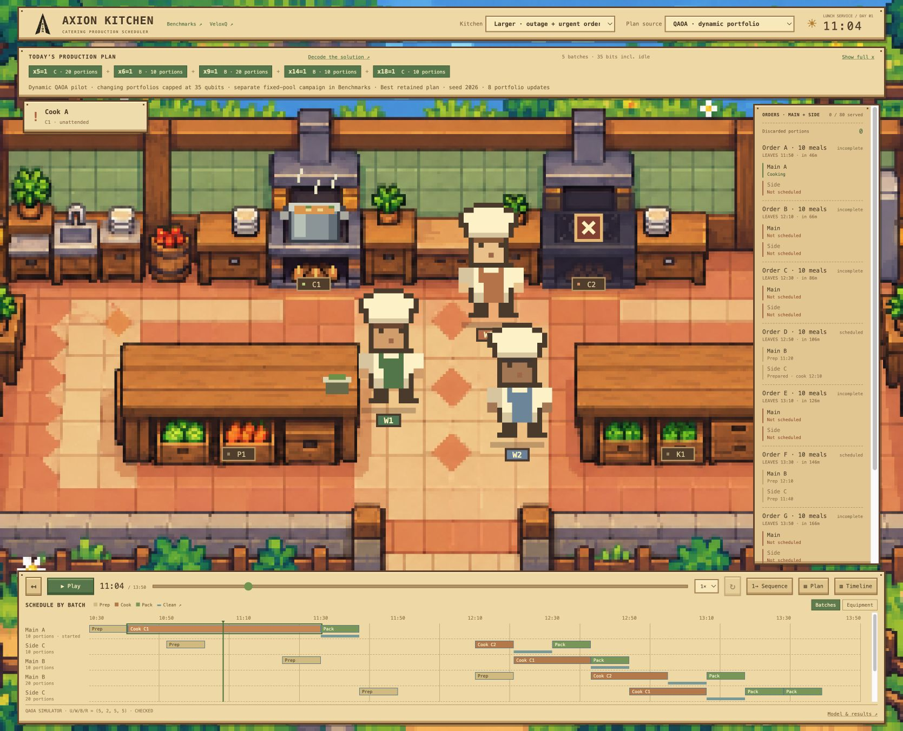

# Axion Kitchen

**[Watch the 4K project video ↗](https://qfactoria.com/video/)** · **[Open the live demo ↗](https://qfactoria.com/)** · [Benchmarks](https://qfactoria.com/catering/benchmarks/) · [VeloxQ results](https://qfactoria.com/catering/benchmarks/#veloxq)

Catering production scheduling with **QAOA, VQE and VeloxQ**, built for the
QPoland Quantum Hackathon 2026. Choose shared batches, cookers, workers and
phase times under deadlines, freshness limits, outages and mandatory cleaning.
It extends manufacturing scheduling with shared batches and paired order fulfillment.

[](https://qfactoria.com/)

*The demo opens with 8 orders and 80 requested meals. It replays independently
checked schedules; fresh quantum sampling is available in the local studio.*

## The optimization

One bit selects a scheduled batch program. The QUBO chooses compatible batches,
prioritizing **missed complete meals → discarded food → batches → plan changes**.
Main and side coverage interact quadratically, without extra product qubits.

- **QAOA & VQE:** 31–35 data-qubit portfolios, simulated in their one-hot sectors.
  The QAOA campaign retains 400 runs with controls.
- **VeloxQ:** larger QUBOs of the same model, at 486, 998 and 2,022 solver bits
  after idle elimination. Driving a checked large-neighbourhood loop, VeloxQ took its
  own plans from 11/13 to 6/7 missed meal lots at 998/2,022 bits, one lot better
  than 30-second CP (longer CP is still better). [Inspect the VeloxQ study](docs/CATERING_VELOXQ_TUNING.md).
- **Validation:** independent physical checks, exact small references and CP/SA
  controls. The complete cell serves 20 meals with zero waste; controls also match it.
- **Decision support:** in the best found 12-customer plans, a third cooker adds no
  served meals, while a prep or packing helper adds 20. These are finite-budget
  classical results, not certified economic optima.
  [Investment study](docs/CATERING_INVESTMENT.md).

The animated dynamic-portfolio pilot and the fixed-pool campaign are labeled
separately. Budgets and limitations are in the [quality report](docs/CATERING_QUALITY.md);
no quantum advantage or physical-QPU result is claimed.

## Run locally

With **Node.js 20+**, from the repository root:

```sh
PORT=4192 npm run dev
```

Open [localhost:4192](http://127.0.0.1:4192/). `npm run build` runs the site checks
and creates the static deployment. For Python setup, fresh sampling and the full
verification command, see [Run & reproduce](catering/README.md).

## Evidence and documentation

| Start here | What it contains |
|---|---|
| [Formal problem statement](docs/CATERING_PROBLEM.md) | Inputs, constraints, objective, QUBO and equivalent formulations |
| [Project design](PROJECT_DESIGN.md) | Problem, QUBO derivation, proofs and variable costs |
| [Stage 1: run & verify](docs/STAGE1_COMPACT.md) · [A](schedule_2x2.json) · [B](schedule_3x3.json) | Required baseline schedules: **4 h / 8 h**; smallest correct time-indexed QUBO for B: **30** variables (72 plain, 39 pruned) |
| [Development log](DEVELOPMENT_LOG.md) | Decisions, experiments and corrections |
| [Verification receipt](output/catering-submission-review-v1/verification.json) | Checked source commit, technical checks and remaining submission steps |
| [Documentation index](docs/README.md) | Method reports, presentation scripts and live-demo runbook |

## License and AI use

Source is [MIT-licensed](LICENSE); assets and fonts retain their accompanying
notices. OpenAI Codex and Anthropic Claude assisted with formulation, code,
experiments, tests, UI and documentation. Team members set the project direction
and solver assignments and handle the final presentation and submission.
The video narration uses a stock Kokoro synthetic voice; no team member’s
voice was cloned. The narration, captions and source hashes are retained.
AI-assisted working notes remain in `docs/internal/` and `docs/archive/`; the
links above identify the active project documents. Measured results and
limitations are recorded in the development log and retained evidence.
