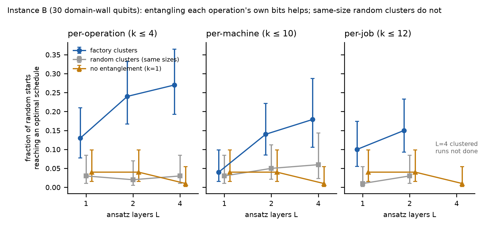

# Stage 2: how much entanglement does scheduling need? (cluster VQE)

Status: 17 October 2026, go/no-go pilot on Instance B only. Exact noiseless
classical simulation; no QPU, no VeloxQ, no shot-noise training. No quantum
advantage is claimed.

## Question

A VQE entangles qubits only inside clusters of size k, with no gates between
clusters. Two questions:

1. Does entanglement help find optimal schedules at all (k = 1 vs k > 1)?
2. Does it matter **which** qubits are entangled together: clusters that
   follow the factory's structure, or random clusters of the same sizes?

The plan is a 2-D grid: problem size (jobs/machines) by cluster structure.
This pilot covers one problem size.

## Why this is simulable, and why that is a feature

With no gates between clusters, the state is an exact tensor product:

|psi> = |psi_C1> (x) |psi_C2> (x) ...

Simulation costs about sum_c 2^|c| amplitudes instead of 2^n. The mean
energy splits into per-cluster terms plus cross terms
b_ij <x_i><x_j>. The model is therefore **not** unsimulable. It is simulable
by design, which lets the grid reach problem sizes where a full statevector
(2^n) is impossible. Per-operation clusters have about 4 qubits whatever the
factory size.

## Setup

| Item | Value |
|---|---|
| Model | `solver.stage1.build_qubo(instance_3x3, 8, "domain-wall")`: 30 qubits, 133 pair terms, wall penalty 10 |
| Optimal bitstrings | 13 of 2^30 (all 512,000 valid domain-wall codewords enumerated; every E=0 codeword decodes to a validated 8 h schedule). Uniform guessing: 1.2e-8 |
| Ansatz | Real amplitudes. Per cluster: RY layer, then L x [CZ chain + RY layer]; L = 1, 2, 4 |
| Loss | Mean energy <E> (exact, not sampled) |
| Gradient | Adjoint differentiation per cluster, using the effective diagonal Hamiltonian from the other clusters' marginals. Checked against finite differences in `tests/test_cluster_vqe.py` |
| Optimizer | SciPy L-BFGS-B, maxiter 2000, one random start θ ~ U(−π, π) per run |
| Success | At least one optimal schedule among 1000 shots sampled from the trained state |
| Clusters | per-operation (that operation's own wall bits, k ≤ 4); per-machine (k = 10); per-job (k ≤ 12); product (k = 1); and, for each factory scheme, a random partition with the same cluster sizes, redrawn per seed |

## Results

Runs reaching an optimal schedule (100 random starts per cell unless stated).
95% Wilson intervals are in [summary.csv](../output/cluster-vqe-3x3-v1/summary.csv).

| Clusters | k max | L = 1 | L = 2 | L = 4 |
|---|---:|---:|---:|---:|
| none (k = 1) | 1 | 4% | 4% | 1% |
| **per-operation** | 4 | **13%** | **24%** | **27%** |
| random, same sizes | 4 | 3% | 2% | 3% |
| per-machine | 10 | 4% | 14% | 18% (67 runs) |
| random, same sizes | 10 | 3% | 5% | 6% (67 runs) |
| per-job | 12 | 10% | 15% | not run |
| random, same sizes | 12 | 1% | 3% | not run |



Findings:

- **The structure of the entanglement matters, not its amount.** Random
  clusters of the same size are no better than no entanglement, even at
  k = 12.
- **The smallest factory-shaped clusters work best.** Per-operation clusters
  (k ≤ 4) beat per-machine (k = 10) and per-job (k ≤ 12). Interpretation, not
  yet tested: entangling one operation's wall bits lets the circuit shift that
  operation's start time as one coordinated move.
- **Failures are near misses.** On average 99.7% of sampled shots are valid
  domain-wall codes. Of the 1,682 unsuccessful runs, 78% have best sampled
  energy 1 or 2 (one or two remaining clashes) and 99% have energy ≤ 4.
- A 25% per-start success rate corresponds to about 1 − 0.75^10 ≈ 94% with 10
  independent restarts. Report both numbers.

## Limits

- One instance (3×3) only. The problem-size axis is not yet measured.
- The run was stopped after 40 minutes. Per-machine at L = 4 has 67 seeds;
  per-job at L = 4 was not run (see `manifest.json`).
- Training uses exact expectations. CVaR training with SPSA/COBYLA under
  shot noise is planned, not done.
- The classical comparison is the exhaustive enumeration above. Larger
  instances need a CP-SAT reference.

## Reproduce

```sh
PYTHONPATH=. python -m unittest tests.test_cluster_vqe -v
PYTHONPATH=. python scripts/run-cluster-vqe.py --summarize output/cluster-vqe-3x3-v1
PYTHONPATH=. python scripts/run-cluster-vqe.py --layers 1 2 4 --seeds 100 --out output/cluster-vqe-3x3-rerun
```

The recorded `runs.csv` was produced interactively with arithmetic identical
to `solver/cluster_vqe.py`. Seventy of its rows (L = 1, 2, all schemes,
seeds 0–4) were re-run with the module and matched exactly.

Code: [solver/cluster_vqe.py](../solver/cluster_vqe.py),
[scripts/run-cluster-vqe.py](../scripts/run-cluster-vqe.py),
[tests/test_cluster_vqe.py](../tests/test_cluster_vqe.py).
Data: [output/cluster-vqe-3x3-v1/](../output/cluster-vqe-3x3-v1/).

Related work: Díez-Valle, Porras and García-Ripoll, *Quantum variational
optimization: the role of entanglement and problem hardness*, Phys. Rev. A
104, 062426 (2021), report that product-state ansätze with CVaR can be
competitive and that entanglement matched to the problem graph helps mainly
for sparse problems.
