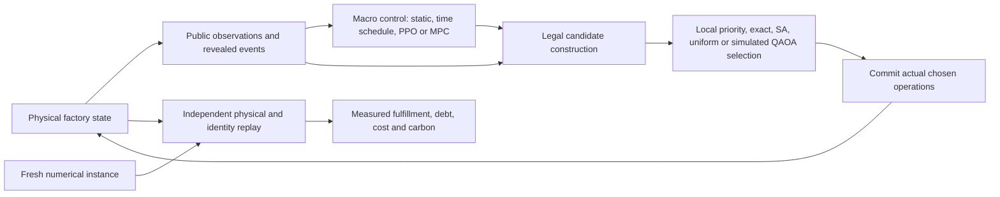

# What the controller actually solves

The factory is large; its integrated quantum subproblems are deliberately small.
This architecture makes execution practical without claiming that a local optimum
solves the whole factory.



Hidden future disruption branches and quality draws are excluded from controller
observations. The engine reveals them at their prescribed events. Independently
sampled MPC futures are hypothetical continuations, not access to the actual
future tape. Offline quality certificates use hidden draws after evaluation and
are a separate proof layer. Empirical paired-prefix checks test leakage on
recorded cases; they do not prove nonanticipativity for every possible history.

## Fixed parameters still produce dynamic schedules

A constant WIP limit and QA protection setting do **not** mean a fixed Gantt chart.
The underlying dispatcher reacts to released parts, occupied machines, qualified
workers, blocked outputs, tool locations, remaining life, battery SOC and revealed
events. Its candidates and actual decisions can change every minute.

For the 96-hour learned-policy contexts, the macro choices are:

| Macro method | What changes | What still reacts to the current factory |
|---|---|---|
| Static control | Its parameters stay fixed | The entire physical dispatcher and candidate filter |
| CEM time schedule | One of six parameter settings in each of eight 720-minute segments | The same dispatcher and filter |
| PPO | A network maps 32 public features to a parameter setting at the declared macro boundaries | The same dispatcher and filter |
| Scenario MPC | Evaluates six settings using two/four sampled continuations every 1440 minutes | Both hypothetical dispatchers and the actual physical dispatcher |

Thus a PPO policy matching a constant macro control can still execute a complex,
state-dependent factory schedule. The experiment fails to establish an additional
benefit from the neural macro controller; it does not establish that factory state
is irrelevant. CEM's selected artifact is a learned time schedule, not adaptive RL.

## Local QUBO and global objective are different objects

An offered binary variable selects a specific operation/crew assignment from the
current candidate pool. Conflict penalties enforce exclusive resources; explicit
capacity constructions include auxiliary bits. The audited penalty exceeds the
sum of positive candidate rewards. Therefore a **global minimum of that QUBO** is
feasible and maximizes that local reward within its fixed pool. Approximate QAOA
samples and a restricted pool do not inherit whole-factory optimality.

The integrated QAOA cap is five total bits, including slack. Larger offers fall
back to a recorded classical selector. Classical feasibility filtering, state
maintenance, angle optimization and rollout planning retain their full costs.
The [larger statevector experiment](STAGE2_QUANTUM_SCALING.md) is separate from
this integrated backend. Neither is a lossless compression of a global QUBO.

Completed executions are assessed first for physical/terminal validity, then
missing orders, cutoff-censored deadline debt and energy-plus-rental cost. Carbon
is reported separately. In symbols, with final revealed demand `O`, shipment time
`s_o` and cutoff `H`:

```text
missing = number of o in O without a shipment by H
debt    = sum over o in O of max(0, min(s_o,H) - due_o)
          (use s_o=infinity for an unshipped order)
cost    = grid-energy tariff cost + paid calibration-tool rental
```

The engine processes completions and reveals at the cutoff, then starts no new
actions. Debt for unfinished demand is censored at that cutoff, not eventual
tardiness. Training rewards and local QUBO rewards are algorithmic surrogates;
we do not claim that they optimize this complete lexicographic objective exactly.
The batch-bonus regression is direct evidence that a better local reward optimum
can produce a worse completed factory execution.

## What a certificate means

For one fixed realized tape, let `L` be a necessary quality/material missing-order
lower bound, `OPT` the unknown best legal missing count and `U` the independently
checked executed count. Then `L <= OPT <= U`. When `U=L`, primary missing is
optimal on that tape, including the nonzero32-demand/31-shipped proof example.
When `U>L`, the interval `[0,U-L]` only bounds unknown primary suboptimality; its
upper endpoint is not the actual gap. No deadline-debt/cost optimum follows.

Likewise, exhausting a radius-two neighborhood of an eight-segment schedule is
exact only for that finite class. Choosing its best schedule separately for each
TRAIN tape is a hindsight oracle. It is neither a deployable nonanticipative
controller nor the best of all `6^8` time schedules. The held-out experiment,
TRAIN oracle and offline certificates answer different questions.

See [the measured result page](STAGE2_RESULTS.md), [method domains and selection](STAGE2_METHOD_SELECTION.md),
and [the QUBO/method audit](STAGE2_METHOD_AUDIT.md) for their exact evidence and limits.
