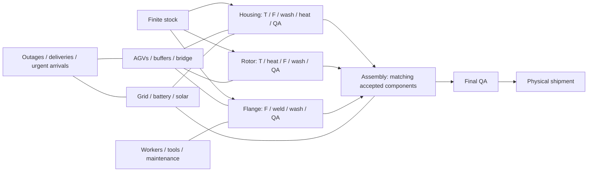

# Stage 2: MetalTech under pressure

Status: ambitious environment proposal, 2026-10-16. The rules below are design decisions proposed in this chat, not organizer requirements or implemented simulation/solver behavior. The accompanying blueprint expands a synthetic workload and audits its structure; it does not establish schedule feasibility.

## Design mandate

Start with the largest coherent problem we can explain: operate a factory under uncertain disruption, rather than merely reorder jobs on more machines. Keep the full environment as the target. Simplify only after a documented failure to model, validate, or solve it, and retain the original case for comparison.

The question is: **Can the factory keep its delivery commitments when production, material movement, people, tools, energy, and unexpected events all compete for the same resources?**

The proposed flagship is a two-hall precision pump factory descended from the organizer's turning, milling, and welding shop. Each delivered pump needs a machined housing, rotor, and flange, followed by assembly and acceptance testing. Optimizing any component independently can make the whole factory worse.

## Flagship workload

| Item | Initial design target |
| --- | --- |
| Planning window | 96 hours, 384 ticks of 15 minutes |
| Customer orders | 24 initially known pump assemblies; up to 2 urgent arrivals |
| Component lots | 72 initially known, one housing/rotor/flange per order |
| Manufacturing operations | 384 initially known, excluding setups, moves, maintenance and rework; 416 if both urgent orders arrive |
| Production machines | 15 across two connected halls |
| Transport | 4 battery-powered AGVs, shared crossing/bridge, 2 chargers |
| People | 10 individually identified workers with overlapping skills and shifts |
| Shared resources | 2 milling tool kits, 2 weld fixtures, 1 calibration kit, finite raw stock and input buffers |
| Energy | Time-dependent grid cap, tariff, solar, carbon intensity, discrete stationary battery dispatch |
| Uncertainty | 8 exogenous event-tree leaves plus separate hidden quality tapes |
| Decisions | Machine, sequence, mode, batch, transport, crew, setup, tool service, maintenance, charging, procurement, recovery and optional mill lease |

These are synthetic design values, not real MetalTech measurements or a demonstrated solvable size. `instances/stage2/metaltech_pressure.json` is the editable parameter source. The blueprint script reports literal counts from it. A configured horizon is not a feasibility certificate.

### Machines and product structure

Hall A contains T1/T2, F1/F2, WASH1, H1 and QA1. Hall B contains F3, S1/S2, WASH2, H2, QA2 and A1/A2. Stock and shipping docks sit on opposite sides. Eligible machines can differ in speed and power; equal capability does not imply interchangeability in time, tooling or quality.

| Component | Required route | Important coupling |
| --- | --- | --- |
| Housing | T → F → WASH → HEAT → QA | Milling tool, furnace batch, material family |
| Rotor | T → HEAT → F → WASH → QA | Reentrant shared resources in a different order |
| Flange | F → S → WASH → QA | Welding fixture and continuously attended welding |
| Final pump | ASSEMBLY → QA | Consumes one accepted housing, rotor and flange from the same order |

Each component lot is one indivisible unit. Assembly consumes three accepted units and creates one assembly unit with explicit parent lineage. Components cannot be consumed twice. An order counts as delivered only after the final accepted pump reaches shipping. Repeating QA across component and assembly routes uses distinct operation IDs.



## Rules that make the environment difficult

### Flexible routing, processing modes and setups

An operation selects one eligible machine and an allowed processing mode. A mode is a tabulated tuple of duration, power, wear and failure probability, not an arbitrary speed slider. Fast milling may finish a critical rotor sooner while increasing power, tool consumption and rework risk. Precision-critical orders disallow uncertified machine/mode combinations.

Setup is an explicit activity determined by the machine's **immediately preceding** material family. It occupies the machine, a qualified setup worker and any required fixture. A setup remains valid while idle, but a repair requiring recalibration can clear it. Do not penalize every earlier family pair: that would model a different problem. The initial family is part of the snapshot.

Tools and fixtures are concrete reusable units. Each unit has a location, remaining life and a holder; a transfer consumes transport capacity. Wear is charged exactly once on the defined processing event, and servicing resets it only after a completed service activity. A family change may be cheap on one machine and expensive on another.

### Batch heat treatment and assembly synchronization

H1/H2 accept up to four components in a compatible temperature/material recipe. All batch members start and finish together; a batch has a fixed recipe duration and power profile even if partly empty. The planner trades waiting for a full batch against releasing a late component. A part cannot be loaded midway through a batch.

Assembly requires all three matched, accepted components physically present in its input buffer. Their earlier completion is insufficient if an AGV has not delivered them. Material genealogy is immutable through rework and replacement.

### Physical transport, finite buffers and blocking

The factory is a graph of machine docks, stock, shipping, chargers and junctions. Every move has an origin, destination, assigned AGV, loading interval, edge traversals and unloading interval. Empty repositioning is mandatory. Reverse edges through a single-lane corridor share capacity, so head-on swaps are forbidden; junction capacity also prevents simultaneous crossing. Travel ticks include handling and safety delays, rather than pretending a 15-minute tick represents vehicle speed alone.

Each AGV carries one unit and has bounded integer state of charge. Loaded and empty travel consume different amounts. Charging occupies a physical charger and contributes to factory electricity demand. An AGV cannot begin a trip it cannot finish under the chosen route and reserve policy.

Each machine has a finite input buffer. A finished part remains on its machine and blocks the next operation until pickup; there is no invisible output warehouse. Reserve destination space before dispatch and retain that reservation until arrival or explicit cancellation. Actual occupancy plus outstanding reservations cannot exceed capacity. Pickup and unloading happen at explicit boundaries. These conservative reservations are part of the model, not a hidden solver heuristic.

Waiting is permitted only at designated holding nodes. A blocked AGV cannot vanish from the bridge. Resource deadlock is a possible state, and the checker must identify its wait-for cycle rather than calling it solver infeasibility. Recovery may use a legal holding location, cancelled reservation or a new dispatch sequence; teleportation is never a recovery action.

### People, shifts, tooling and maintenance

Ten named workers have skill sets, calendars and individual occupancy. Setup, welding, QA and assembly have specified attendance requirements. Automatic machining needs a worker at load/unload; attended welding needs one throughout. One multi-skilled person cannot fill two simultaneous roles. Breaks, handovers and overtime are explicit calendar or decision records.

Machine wear accumulates by completed workload/mode. Preventive maintenance occupies the machine and a qualified mechanic for a tabulated duration, then resets wear. Crossing the hard wear limit is prohibited. Failure events are sampled externally or from a declared state-dependent hazard table; the scheduler can reduce exposure but cannot choose whether an unseen random event occurred.

### Energy, carbon and operating budget

For every tick, integer kW balance is:

`grid + solar_used + battery_discharge = base_load + machine_load + setup_load + AGV_charge + battery_charge`.

Grid import lies in `[0, grid_cap(t)]`; no export is allowed, and unused solar is curtailed. The cap may be reduced by an announced grid event. Setup, maintenance and chargers use their own declared load, rather than all being free.

The stationary battery chooses idle, charge at 10 kW, or discharge at 9 kW. One 15-minute charge adds 9 units of 0.25 kWh; a discharge removes 10 units. Thus both directions have 90% conversion efficiency. SOC is bounded and charge/discharge are mutually exclusive. This finite action table avoids rounding-created energy. Initial SOC is declared and the terminal SOC must be at least its initial level, so a plan cannot win by consuming free starting energy. AGV batteries obey their separate action tables.

Price is in integer currency subunits/kWh and carbon intensity in integer grams/kWh, with an explicit integer scaling for tick costs. A hard cash budget limits procurement, overtime and leased capacity; operating costs and carbon are reported separately. Emergency material purchases have a lead time and physical arrival dock. A strategic mill lease can be activated with a fixed fee, activation delay, footprint and electrical requirements; it does not appear instantaneously.

### Quality, rework and bounded replacement

Acceptance is observed only when QA completes. Each potentially inspected unit has hidden, keyed uniform draws for its permitted attempts. A draw is compared with the declared mode/material/wear-dependent failure threshold. Different policies use the same keys, so changing scheduling order does not resample luck. The policy sees outcomes, not the hidden draws or future outcomes.

A failed component is quarantined. One permitted repair route returns it to the relevant machining/welding step, then cleaning and QA. A failed repair scraps it. At most one replacement component can be started from new stock; replacement itself has a declared finite attempt budget. Final assembly QA failure can trigger one disassembly, preserving or consuming components according to its explicit repair recipe. Every conditional operation belongs to a bounded, unrolled DAG; there is no infinite rework cycle.

An unsuccessful terminal order remains an unmet commitment with its inventory/cost history. Distinguish **physical feasibility**, **all orders fulfilled**, and **optimality**. A physically valid failure policy is not a successful factory solution.

### Mid-operation disruption and rolling replanning

Start from a snapshot generated by replaying a valid burn-in: some tasks complete, some run, AGVs have locations/battery levels, and buffers contain real units. Save the burn-in trace, rather than hand-authoring a convenient but unreachable WIP state. The current blueprint has not generated this snapshot yet.

Every completed action is immutable. In-progress work follows its interruption table: a resumable machining operation pauses with its remaining work and continues to occupy the machine/part; an interrupted nonresumable heat/weld batch is quarantined for the declared recovery route. A failed machine cannot be rerouted while still holding a part without a legal unloading/recovery action. Maintenance and transport also need explicit interruption rules.

Replan every four ticks and on a revealed disruption, urgent arrival or quality failure. Use a four-tick commitment window: already dispatched moves and active operations stay committed; cancelable future actions may change at an explicit churn cost. A new physical impossibility overrides a commitment and is logged as an emergency exception, not silently ignored.

## Uncertainty and information discipline

Use three binary exogenous branching points to produce eight leaves. Their events concern a milling outage, a power/delivery shock, and urgent orders. Each node has a reveal tick, parent, conditional probability and event payload. Shared prefixes must execute identical decisions until the relevant observation. Leaf probability is the product along its path; simultaneous shocks within a node intentionally model correlation.

The event tree is an evaluation/planning structure, not a future-events API for the controller. The execution engine retains hidden events and random tapes; `observe()` returns only revealed information. Future customer arrivals are not included among the controller's known orders before their reveal.

Quality outcomes require extra care: inspection completion time depends on decisions. They are revealed at the actual QA-completion event, **not** at the next fixed exogenous tree node. For full stochastic optimization, policies must be indexed by observation history, including these outcomes. For an initial implementable comparison, optimize recourse over the exogenous tree with a declared quality approximation, then evaluate all policies against the same hidden quality tapes. Label that approximation; do not claim the full stochastic optimum.

Do not independently optimize each leaf and average the result as if it were an executable policy. That calculation is a clairvoyant lower bound, useful only when labeled. Compare causal policies against causal policies.

## State, actions, transitions and objectives

State at tick `t` includes unit lineage/location/acceptance, released orders, stock, operation progress, machine family/wear/status, worker/fixture/tool location and calendars, buffer reservations, AGV position/cargo/SOC, stationary SOC, cash, current commitments and observed event history. Hidden state contains future shocks and quality tapes. A deterministic transition takes state, legal joint action and newly revealed exogenous input to the next state.

Action types: reserve/release buffer; start/finish setup; load/start/finish processing; form/start/unload batch; assign worker/tool; dispatch/traverse/unload AGV; charge; maintain/repair; procure; activate leased capacity; ship; and publish/cancel a future commitment. A legal compound action must resolve its subevents consistently.

All intervals are half-open. At a boundary: finish ongoing work/travel, reveal events and QA outcomes, update inventory and reservations, apply outages, then admit new starts under updated capacity. A completion at the outage boundary succeeds; work extending beyond it follows the interruption table. Atomic actions cannot borrow capacity before the release phase. Record tie-breaking as part of the engine version.

The objective is lexicographic:

1. Minimize expected count of unfulfilled mandatory orders, also reporting worst-case and fulfillment probability.
2. Among equivalent fulfillment outcomes, minimize expected contractual tardiness cost plus `lambda * CVaR_0.9(tardiness_cost)`.
3. Minimize operating cost, priced carbon, plan-change cost and terminal WIP debt under fixed published coefficients; use makespan as the final tie-break.

For completed order `j`, `T_j = max(0, delivered_tick_j - due_tick_j)`. Noncompleted orders use the declared terminal deadline debt at the evaluation horizon; they also incur objective tier 1, so dropping a difficult order is not a shortcut. The horizon and terminal convention are frozen across methods. Report every component, rather than only a composite score.

For discrete scenario losses `L_s`, CVaR is represented by `eta + sum_s p_s * u_s / (1-alpha)`, with `u_s >= L_s-eta` and `u_s >= 0`. Probabilities and costs need rational/integer scaling in a solver. Publish alpha, lambda, loss definition and sample population. Do not compute CVaR on infeasible runs as if they were valid low-cost outcomes.

Hard physical constraints are never traded for money. For scalar QUBO subproblems, derive finite bounds on lower-priority objective ranges before choosing lexicographic multipliers. If a squared integer constraint has minimum nonzero violation 1, a penalty greater than the total possible objective improvement suffices for that finite encoding. Coefficient range/precision may still make such weights impractical; measure this rather than choosing an unexplained large constant.

## Where QUBO and VeloxQ can do meaningful work

### Exact conceptual formulation: finite state/action flow

The finite tick horizon, bounded inventories/attempts and discrete actions define a finite transition graph. Binary transition choices, unit flow from the initial state and action consistency describe legal trajectories. A stochastic policy extends the flow over observation histories, enforcing shared actions for indistinguishable histories. Illegal transitions are absent; finite integer objective/risk auxiliaries can be binary encoded and equality constraints squared.

This is an exact conceptual route to a QUBO for the discretized finite environment, subject to explicit risk/objective encoding. It is potentially enormous because a joint state contains many resources. It establishes a modeling reference, **not** an efficient encoding, implementation, or assertion that a full-factory QUBO fits a quantum simulator.

### Practical research direction: QUBO recovery neighborhoods

At a disruption, freeze the executed prefix and choose a closed set of affected decisions: e.g. 6–12 components competing for F1/F2/F3, their setup transitions, reserved destinations, assigned tools and near-term power. Generate alternative executable bundles with explicit resource footprints and entry/exit state signatures. Ask VeloxQ to choose compatible alternatives that improve a matched recovery objective.

For choice groups `g` and candidate bundle bits `z_b`, a proposed restricted QUBO is:

`E = sum_b c_b*z_b + A*sum_g(sum_{b in g} z_b - 1)^2 + B*sum_{(b,c) in I} z_b*z_c + sum_r P_r*(sum_b a_rb*z_b + slack_r - cap_r)^2`.

`I` contains proven pair conflicts; additive rows account for cumulative power, storage or budgets, with bounded integer binary slack. Exactly-one applies only where groups genuinely partition the choices. A bundle may need to cover an entire affected machine sequence, not an isolated operation, to capture predecessor-dependent setups. Entry/exit state mismatches require linking variables/constraints or merged bundles. Cross-boundary inventory, future wear, worker travel, batch members and AGV return positions must all be in the closure; pair conflicts alone cannot express every global interaction.

Only call this exact **over the enumerated candidate pool and fixed boundary** after exhaustive checks. It is an approximation to the full environment when generation restricts options. More candidates do not automatically recover the global optimum. Count candidate generation, classical repairs, rejected samples and scheduling validation in end-to-end runtime.

Compare the identical restricted subproblem under VeloxQ, a classical QUBO method and exact enumeration/CP-SAT where tractable. Separately compare the full causal hybrid policy against a full causal classical policy under equal planning budgets. Include a policy using the same candidate generator with classical selection, so gains cannot be attributed to VeloxQ merely because the classical generator did most of the work.

Small QAOA experiments can use the same recovery-neighborhood semantics. No full-factory quantum advantage or speedup is assumed.

### Price of realism ledger

Let `O` be operation instances, `H` ticks, `K_o` machine/mode alternatives, `E` transport edges, `V` AGVs, `F` families, and `S` scenario/history copies. Counts below describe constructions to investigate, not achieved reductions.

| Addition | Naive formulation burden | Compact candidate / audit requirement |
| --- | --- | --- |
| Flexible machines and modes | `sum_o sum_k max(0,H-duration_ok+1)` start bits before pruning | Remove only provably impossible starts/options; record dominance assumptions |
| Precedence/BOM joins | Couplers and activation/lineage variables; may add zero start bits if domains already exist | Component identity must survive reduction |
| Family setups | Explicit predecessor/transition or machine-family state bits; not merely extra pair conflicts | Sequence bundles or linked boundary state |
| Batches | Batch membership, presence, start/recipe choices | Enumerated compatible batches; record excluded batches |
| AGV routing/charge | Time-expanded vehicle/node/edge/SOC choices, roughly `O(V*H*(nodes+E))` before SOC expansion | Route bundles including empty return and charging |
| Buffers/blocking | Occupancy/reservation rows and slack/state bits | Check physical occupancy and reservations independently |
| Crew/tool/wear | Assignment/location/availability/state bits | Explicit entry/exit signatures and service actions |
| Grid/battery/budget | Per-tick dispatch/SOC/slack bits and accounting rows | Fixed-footprint bundles plus correctly bounded slack |
| Rework/scrap | Activated bounded attempt DAGs; replacement inventory | Never remove failed attempts from the accounting trace |
| Uncertainty/recourse | History copies plus nonanticipativity links | Shared-prefix variables; no anticipative pruning |
| Rolling state | Existing decisions become constants; new boundary links may add bits | Count net changes, not only removed variables |

Report start bits, state/assignment bits, slack bits, ancillas, nonzero couplers, density, coefficient range, generation time and validation time separately. Baseline 3×3 counts remain a separate required comparable result. The blueprint count is only the nominal manufacturing-start component, not a total QUBO size.

The initial audited blueprint has 1,752 machine/mode alternatives across its 384 nominal operations: 672,768 candidate bits if every alternative receives all 384 start ticks, or 665,760 after removing only starts that finish outside the horizon. These deliberately naive counts precede release/precedence/certification pruning and do not represent a correct complete batch/transport/stochastic QUBO. They are logical binary counts, not physical qubit requirements.

## Environment and visual experience

Keep the existing Stage 1 viewer as its own mode. Stage 2 needs a new versioned domain contract; its DAGs, conditional operations and 15 machines cannot be forced into `axion-replay.v1`.

The factory stays the main view, with two halls, buffer occupancy, moving loaded/empty AGVs, charging and actual machine states. Original pixel art can retain the current direction while scaling through camera pan/zoom and semantic detail. Avoid putting 15 equally sized metric panels above the factory.

Proposed interactions:

- Select a pump: highlight its three component lineages, accepted/rework/scrap status and the missing input preventing assembly.
- Select an idle machine: show the causal blockers (no worker, no tool, no stock, no power, blocked output), with links to the actual resource reservations.
- Inject a published event: fork the same saved state into recovery-policy runs; preserve the prefix and random tape. Compare executed outcomes on linked timelines.
- Scrub a disruption: show the old commitments, interrupted work, new reservations and recovery actions. Mark the exact moment information became observable.
- Switch overlays: production/transport, energy, people/tools, quality and formulation. Each overlay reads the same event trace.
- Inspect a solver sample: connect a chosen bundle/violated term to the physical action; distinguish raw infeasible samples, repaired samples and independently accepted policies.
- Explore the mill lease: compare fixed-cost, lead-time, tool, grid and transport effects on identical scenarios, rather than assuming more machines always help.

Explainability should be causal and testable. A blocked-reason trace is factual; a claim that buying a machine *would* improve delivery requires a matched counterfactual run. No fake live optimizer or illustrative metrics labeled as measured results.

## Implementation boundary and evidence

Proposed engine interface:

```text
load(instance, burn_in_trace, hidden_tape) -> full_state
observe(full_state, actor=controller) -> public_observation
legal_actions(public_observation) -> action_domain
step(full_state, joint_action) -> new_state, public_events, trace_rows
check(instance, initial_state, full_trace) -> physical_issues, fulfillment, objective_components
policy.plan(observation, commitments, budget) -> contingent_plan, method_artifact
```

The independent checker replays primitive trace events, reconstructing capacity, locations, conservation, SOC, work, setup family and lineage. It must not trust cached occupancies, reported makespan, solver energy or the engine's own legality verdict. Differential tests use another representation on small cases.

Artifacts need instance/version/hash, snapshot and trace hashes, observation history, scenario/tape identifier, timing boundaries, candidate pool and all rejected candidates/samples, coefficients, actual backend metadata and objective decomposition. Public traces can reveal a completed hidden tape for reproduction, but policy input remains restricted during execution.

## Iteration program: preserve ambition, test the weak links

1. **Coherence iteration (this change):** competing ideas, full rules, parameterized flagship, structural workload audit, unresolved semantics listed. No solve claims.
2. **Environment iteration:** deterministic event engine, complete action tables and reachable burn-in snapshot. Keep every flagship mechanism enabled; use tiny fixtures to test each invariant and its interactions.
3. **Classical reference iteration:** exact small instances of the same rules; on larger cases record incumbent, bound, timeout and unsupported features. A reference solving only production while ignoring transport is a different model.
4. **Encoding iteration:** validate raw/pruned extended start domains and exact tiny recovery QUBOs against independent enumeration. Exhaust all bitstrings where practical. Prove boundary closure and check penalty margins.
5. **Hybrid iteration:** identical neighborhood pools with classical and VeloxQ selection; full policy matched-budget tests; genuine small quantum experiments where useful.
6. **Stress iteration:** full 24-order flagship, all mechanisms active, then scale orders/resources/horizon and event severity independently. Use at least 20 paired policy runs if practical, recording individual outcomes, not just the best seed. Separate development and held-out tapes.
7. **Counterfactual iteration:** mill lease, extra AGV, extra buffer slot, larger battery and cross-trained worker. Identify when the bottleneck migrates and when capacity investment has negative value.

Hypotheses to falsify: a faster mill can worsen deliveries under grid contention; more buffer capacity can break a transport deadlock; locally earliest-due dispatch can starve assembly; a small, closed recovery QUBO can retain useful solutions after a large disruption; robustness and schedule stability can conflict.

The faster-mill hypothesis concerns a specified policy or a forced operating change. Adding a free, optional action/resource while preserving every old feasible policy cannot worsen the mathematical optimum. A harmful mill lease can arise from its fixed fee, required footprint/power changes, or a heuristic's response. Keep these cases distinct when interpreting a counterfactual; otherwise a compelling story could conceal a modeling bug.

Measure feasibility rate, fulfillment, weighted tardiness, CVaR, costs/carbon, churn, throughput, reference bounds/gaps, model sizes and whole-loop time. Diagnose any all-infeasible case before benchmarking algorithms. For stochastic policies report empirical uncertainty and the evaluated distribution; eight designed leaves are not evidence of real-world robustness.

### When simplification becomes justified

Do not remove mechanisms merely because the flagship looks hard. First attempt representation improvements, stronger bounds, exact domain pruning, neighborhood closure and more compute within authorized resources. A simplification requires a saved failing instance/trace, the precise obstacle, attempted remedies and a before/after comparison.

If eventually required: reduce workload size while retaining rules; then reduce event-tree breadth; then coarsen a declared physical representation (e.g. fixed transport paths); then remove a mechanism with an explicit ablation. Keep full-size and full-rule cases as unsolved results. An audit fixture is not a replacement flagship, and a restricted solver is not a simplified environment.

## Open design decisions before engine implementation

The blueprint intentionally does not invent a fully runnable environment. Before transition code, tabulate every machine/mode duration/power/quality entry, setup matrix, worker calendar/travel time, tool wear table, batch compatibility, buffer rule at each dock, AGV load/charge table, interruption/rework recipe and objective coefficient. Generate and independently check the warm start. Confirm whether the 96-hour horizon admits full fulfillment under each declared event case; extend it explicitly or report failures if it does not.

Potential research expansions remain inside the same system: shared-component allocation across compatible orders, alternative manufacturing routes, limited outsourcing with transport and QA, and an adversary choosing a bounded disruption budget. These are idea candidates, not enabled features in the current blueprint; the target above is already much richer than an ordinary flexible job shop.

## Sources and interpretation

- Local `Quantum_Hackathon_2026_ERP_Challenge.pdf`, §§3,5,8,11,14: domain freedom, extended-model correctness/reduction evidence, design detail and output-schema freedom. Its encouragement of depth is a requirement for our evidence, not a reason to cap the user's requested ambition.
- [Google OR-Tools flexible job shop example](https://github.com/google/or-tools/blob/stable/examples/python/flexible_job_shop_sat.py): optional machine alternatives and a scheduling reference starting point. It does not implement the complete environment above.
- [OR-Tools CP-SAT model source](https://github.com/google/or-tools/blob/stable/ortools/sat/python/cp_model.py): interval, cumulative and reservoir building blocks. Composing our exact reference and checker remains project work.
- [Lucas, Ising formulations of many NP problems](https://arxiv.org/abs/1302.5843): general penalty-based binary modeling background; our state-flow and neighborhood proposals require their own correctness arguments.

The particular factory, interactions, scales, solver role and experimental hypotheses are proposals developed here, not claims extracted from these sources.
