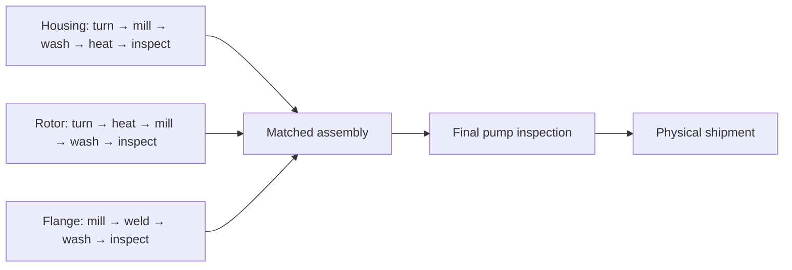

# What we actually have: Stage 1, the factory, and the planning experiments

**Historical explanation, 17 October 2026:** this document covers the earlier
physical factory and planning studies. The pause described in those studies
was superseded by authorized implementation. Start with [current status](STAGE2_STATUS.md)
for the completed 32-operation manufacturing recovery entry, integrated
whole-recipe QAOA, economics, final acceptance and remaining release duties.
The [smaller validation cell](STAGE2_ENTRY.md) has a separate scope. Original
outcomes below remain unchanged; they are not results for one unchanged model.

The current work contains **a rich factory simulator with tested controllers**
and **separate, more rigorously formulated scheduling benchmarks**. Our best
full-factory results are classical. Quantum algorithms genuinely ran on
simulators, but we have not demonstrated that they outperform the classical
controls. The newer 21-qubit experiments are not the controller responsible for
the full-factory shipment numbers.

Open the plain-language visual guide at
[Stage 2 — Start here](http://127.0.0.1:4187/stage2/start.html), then use the
[physical factory replay](http://127.0.0.1:4187/stage2/?view=factory) and
[separate planning/reference view](http://127.0.0.1:4187/stage2/planning.html?scaling=1).

## 1. The four things that must be kept separate

|Artifact|What problem it represents|What solves it|What its result means|
|---|---|---|---|
|Official Stage 1 A/B|Tiny fixed-machine flow shops:2 jobs×2 machines,3 jobs×3 machines|Actual simulated QAOA, with exact classical checks|Optimal completion times 4 h and 8 h|
|Full physical Stage 2 factory|Parts, workers, machines, vehicles, tools, stock, energy, quality and revealed disruptions over time|Classical state-dependent dispatch; tuned/learned macro settings; scenario MPC; optional local QUBO selectors|Checked shipments, misses, lateness and costs under the complete implemented factory rules|
|Separate physical reference fixtures|Smaller deterministic factories retaining transport, blocking and matched assembly, with many flagship features disabled|CP-SAT and independently checked physical witnesses|Exact/bounded makespan for those fixtures only|
|New bounded planning cells|Complete pump recipes with machine/worker/start assignments, calendars, BOM, minimum transfer lags and optional machine-only setups|Complete declared-model QUBOs, independent CP-SAT references, restricted candidate pools and conditional QAOA experiments|Quality/size/circuit evidence for that declared deterministic cell, not full-factory throughput|

An operation count alone does not identify the model. Two pumps mean 32 nominal
manufacturing operations in both kinds of reference, but the constraints and
objectives differ. For example, **863 minutes** is the optimum makespan of one
physical transport fixture; **908,670** is a lateness-plus-makespan score of a
different planning cell. They are not competing answers to the same problem.

### How to read the competition's quantum requirement

Section 5 explicitly connects factory realism to a compact, accurate and
understood quantum solution. It asks for an integrated result: formulation
reduction, algorithm comparisons and scaling on the extended model, with a
same-model classical reference and disclosed losses. Decomposition and
partitioning are explicitly permitted. It does not require quantum advantage
or one monolithic quantum execution of every physical mechanism.

The rich simulator alone therefore does not answer the quantum focus. The gap
between its small local selectors and the separate, more complete planning-cell
QUBOs is a substantive submission weakness. See the new
[step-by-step problem and encoding document](STAGE2_PROBLEM_WALKTHROUGH.md), or
its [readable HTML edition](../../stage2-problem/index.html), and
[challenge §5](../../../Quantum_Hackathon_2026_ERP_Challenge.pdf#page=2).

## 2. What Stage 1 asks

A job is a fixed chain of operations on specified machines. An operation has a
known duration. A machine can process one operation at a time; a job's next
operation must wait for its predecessor. The goal is **makespan**: the time when
the last job finishes.

There are no matched component assemblies, AGV trips, worker qualifications,
electricity limits, uncertain quality failures, stock deliveries or urgent-order
revelations in these baseline instances.

The selected compact representation chooses a common job order and decodes its
earliest legal starts. A has two orders and uses 1 binary variable; B has six
orders and uses 3 variables, with cyclic orders rejected. Actual QAOA simulator
samples produce the 4 h/8 h optimum schedules. An independent broader machine-order
enumeration confirms those global optimum values for the official instances.

The important qualification: constructing the tiny compact model evaluates all
2 or 6 common orders classically. That already reveals the tiny optimum. This
is a correct and inspectable Stage 1 demonstration, not evidence that quantum
computation was necessary or that the same compression scales to the factory.
See [the full Stage 1 explanation](../../STAGE1_COMPACT.md).

## 3. The main Stage 2 problem, in ordinary language

We run a synthetic factory making pumps. Each order needs **its own housing,
rotor and flange**. Those three accepted components must physically meet at
assembly. Then the assembled pump must pass final inspection and reach shipping.

An **order** is the customer's pump. A **component** is a physical housing,
rotor or flange belonging to that order. An **operation** is one manufacturing
step, such as milling that housing. A **recipe** is the component's ordered
route. **BOM** means bill of materials: the required matched component set.

In scheduling terms, this is a flexible manufacturing and matched-assembly
problem coupled to material handling, workforce, energy and causal control
under uncertainty. The numerical runtime definition is `stage2/spec.py`, which
expands the synthetic JSON blueprint; old design-status labels alone do not
establish that a feature is implemented.



That is 5 housing operations+5 rotor+4 flange+assembly+final inspection=
**16 nominal manufacturing operations per pump**. Thus 12/24/32 initial orders
have 192/384/512 nominal operations. Setups, maintenance, transport, repairs,
replacement routes and urgent orders add work beyond that count.

### Machines and routes

There are 15 machines in two halls:

|Process|Machines|Where|
|---|---|---|
|Turning|T1,T2|Hall A|
|Milling|F1,F2,F3|F1/F2 in A; slower F3 in B|
|Welding|S1,S2|Hall B|
|Washing|WASH1,WASH2|One in each hall|
|Heat treatment|H1,H2|One in each hall|
|Inspection|QA1,QA2|One in each hall|
|Assembly|A1,A2|Hall B|

Operations may choose an eligible machine. Choosing the nearer machine can save
transport but create congestion; choosing a slower machine can free a scarce
station. Standard nominal times include 60 min turning,90 min housing milling,
120 min heat treatment,45 min ordinary inspection and 60 min assembly. Rotor milling
takes 75 min; flange milling/welding take 60 min each; washing takes 30 min.
Machine factors and chosen modes change applicable times. Every fourth initial
order requires slower precision inspection,68 min after integer rounding.

### People, setups and calendars

There are 10 individually tracked workers, with explicit skill sets. They have
daily 8 h shifts and two 30 min breaks. Four workers cover the first shift, three the
second, three the third. A machine being idle does not mean a qualified person
is available. Walking between halls takes 2 min in the implemented fine profile.

|Worker|Daily shift|Skills|
|---|---|---|
|W01|00:00–08:00|Setup, machining, maintenance|
|W02|00:00–08:00|Welding, setup|
|W03|00:00–08:00|QA, assembly|
|W04|00:00–08:00|Machining, assembly, QA|
|W05|08:00–16:00|Setup, machining, maintenance|
|W06|08:00–16:00|Welding, assembly|
|W07|08:00–16:00|QA, assembly, setup|
|W08|16:00–24:00|Setup, machining, maintenance|
|W09|16:00–24:00|Welding, assembly|
|W10|16:00–24:00|QA, assembly, setup|

Each shift's breaks start 3 h 30 min and 6 h 30 min after its start.

Turning, milling, washing and heat treatment require 5 min start attendance.
The worker can then leave while the machine remains occupied. Welding,
inspection and assembly require attendance throughout the operation. Required
attendance and walking must fit legal working intervals; work cannot cross a
break by pretending that the worker stayed available. Automatic machine
processing may continue across a worker's break after legal start attendance
has ended.

Orders cycle through three material families. A family change occupies the
machine for 30 min or 45 min; same-family changeover is 0. In the full factory it
also needs a qualified setup person. Sometimes one worker can perform both
roles; otherwise a separate setup worker is needed. This creates a real
sequence-dependent tradeoff, not merely an extra cost attached after scheduling.

### Moving things and making space

Four battery-powered AGVs carry one part or portable tool at a time. They travel
over a graph with exclusive lanes and a shared bridge of capacity 1. Empty travel,
loading/unloading, charging and delivery reservations take time.

Machines have finite input/output space. A completed part can block its machine
until collection. A trip reserves destination space before departure. A component
cannot teleport to a free station or count as available for assembly while it
is still on a vehicle. Tool trips compete with part trips.

### Tools, wear, batches and maintenance

There are two milling kits, two welding fixtures and one calibration kit, each
with a location, 600 processing minutes of life and 60 min service time.
Tool service and machine
maintenance are different resources/actions. Machine wear depends on processing
and mode; its threshold is 1,050 standard wear units, and preventive maintenance
takes 75 min and restores the machine's wear
state. Heat treatment can batch up to 4 compatible same-family parts, subject to
its actual loading/resource rules.

A controller may rent one additional calibration kit for 150 model-cost units,
with an 8 h delivery lead time and an investment budget of 250. This is a portable
tool rental. Machine leasing and emergency procurement are not implemented.

### Materials, quality and uncertainty

The factory begins with 30 blanks per component type and a scheduled delivery of
4 more. Normal delivery is at hour 30; a supply-stress branch moves it to hour 39.
Materials are finite. Scrapped parts cannot be replaced indefinitely.

Manufacturing modes affect duration, power, wear and accumulated defect risk.
Inspection reveals quality outcomes. Repair and replacement are bounded: an
original component can have at most one replacement; repair/reinspection can
still fail. Faster production can therefore generate more downstream work or
lose a component needed for a matched pump.

Repair takes 45 min; replacement has a 180 min lead time. Repair retains a 2%
residual failure probability. Base mode/process defect probabilities and a
wear contribution accumulate through manufacturing history rather than treating
all finished components as one identical coin flip. Precision orders restrict
turning/milling to eco or standard modes and require precision inspection.

Quality outcomes use stable unit/attempt keys. Renaming a part is not permission
to redraw a failure. The controller does not see those hidden future draws.

There are three disruption revelations:

|Reveal time|Possible change|
|---|---|
|12 h|F2 outage from 12 h to 18 h, probability 35%|
|24 h|Grid cap falls 90→45 kW for 24–36 h and stock delivery is delayed, probability 40%|
|40 h|Two urgent precision orders appear, probability 50%|

The three binary branches give eight exogenous leaves; inspection draws add
further randomness. Policies may react to a revealed event. Scenario planning
can sample possible futures, but cannot inspect which actual hidden branch or
quality draw will occur.

### Electricity and terminal conditions

There is a 90 kW normal grid cap,12 kW base load, time-varying tariffs/carbon,
deterministic solar up to 16 kW, and a lossy 40 kWh stationary battery. It begins at
10 kWh, must stay above 2 kWh and must finish with at least 10 kWh. Battery charging
and AGV charging compete with manufacturing loads. The model does not allow
free export revenue or an empty battery at the cutoff to masquerade as a cheap
complete solution.

Investment has a hard budget. Electricity cost and carbon are measured, but
hard total operating-cost/carbon caps are **not** implemented. Overtime,
general interruption/resumption, emergency purchases and leased machines are
also absent. The factory is synthetic and internally specified; it is not an
industrially calibrated digital twin.

### What we optimize in the full factory

First, an execution must obey physical and terminal rules. Among valid
executions, the priorities are:

1. Minimize orders not physically shipped by the cutoff.
2. Minimize cutoff-censored deadline debt.
3. Minimize energy-tariff plus rental cost. Carbon is also reported.

The cutoff or **planning horizon** is when evaluation stops, normally 96 h.
A **due date** is when an order should have shipped; it can be much earlier.
"All orders shipped" therefore does **not** mean "all orders on time."
An unshipped order contributes debt through the cutoff; we do not invent its
eventual completion date. Initial order due dates cycle through 40,46,52,58,64,70 h.
Initial release dates cycle through 0,2,4,6 h. An unreleased order's components
cannot begin production merely because a machine is free.

A valid run can ship very little. A run that ships everything can be late and
expensive. A good observed result is not automatically globally optimal.

## 4. How the full factory is actually solved

There is no single huge optimization call choosing every future action jointly.
The implemented controller repeatedly does the following:

1. Read current public state, completions and revealed events.
2. Admit a bounded set of orders into active work and prioritize their parts.
3. Choose routes/modes, arrange workers and tools, and build legal start offers.
4. Select compatible operations to start now; arrange transport, charging,
   servicing and maintenance through the physical controller.
5. Advance the world, observe new state, and repeat.

Several control layers sit above that machinery:

|Method|What it actually changes|Current evidence|
|---|---|---|
|Tuned static parameters|Fixed WIP/admission, urgency and scarce-resource protection settings|Strong, cheap baseline; its actual dispatch remains state dependent|
|CEM time schedule|Learns which macro setting to use in each of eight time segments|Useful at 24 orders; not an adaptive neural policy|
|PPO|A neural network chooses macro settings from 32 public state features|No additional adaptive-RL benefit established over its matched constant control|
|Scenario MPC|Simulates independent possible continuations and chooses a setting|Improves 12/16-order quality at much greater CPU cost; worsens 24-order results|
|Local exact/annealing/uniform/QAOA selector|Chooses from the current legal start offers|Genuine finite local QUBO comparison; no measured quantum advantage|

A fixed macro setting is not a frozen Gantt chart. All the lower-level resource,
inventory, worker and transport decisions still react to the current state.
Conversely, a complicated simulator does not imply its controller optimizes
all those choices globally.

An independent checker reconstructs execution from a fresh numerical instance;
a separate identity audit checks births, replacements and quality keys. These
are substantive checks, but they do not prove every possible future policy is
optimal or nonanticipative. See [control layers](STAGE2_CONTROL_LAYERS.md).

## 5. How good the full-factory results are

These are the **preselected cheap classical controllers**, not quantum results.
Each row uses 256 frozen final environment tapes with the proper eight-leaf
probability weights. Urgent demand can add two orders.

|Initial orders|Calendar|Probability all final demand ships|Mean missing orders|
|---:|---:|---:|---:|
|12|96 h|94.98%|0.0750|
|16|96 h|8.80%|2.6906|
|24|96 h|0 observed|10.0209|
|32|**240 h**|91.02%|0.1023|

The 12-order controller is useful. The 16/24-order,96 h cases expose a serious
performance problem. These failures do not alone distinguish physical capacity
limits from bad decisions. The 32-order result grants six extra days and has
heavy lateness; it is not evidence that 32 orders work well in 96 h.

More expensive scenario MPC reduces mean misses to 0.0377 at 12 and 2.3014 at 16;
its 16-order all-shipped probability is 17.41%. At 24 it is worse, with 11.2677
mean misses. Thus there is a quality/runtime choice, not one universally best
controller. The original preselection is preserved even when another final
method performs better; we do not silently rewrite the benchmark winner.

Measured cheap-controller episodes at 12/16/24 orders take about 3.33/3.41/3.77
process CPU seconds, versus 156/113/255 seconds for the declared MPC comparisons.
These include factory simulation and checking, not just one decision's latency,
and are not normalized timing comparisons across different hardware.

In matched 12-order selector experiments, QAOA has 0.1503 mean misses, simulated
annealing 0.1183 and uniform sampling 0.1401. The declared comparison intervals
cross zero. **Quantum advantage has not been demonstrated; equivalence has
not been proved either.** These selectors must not be credited with the cheap
classical controller's 0.0750 result.

The complete frozen campaign contains 23,552 valid executions,74 method/context
groups and 592 independently rechecked retained traces. Full-factory primary
missing-order bounds exist on realized tapes, but global deadline/cost optimality
and the optimum causal stochastic policy remain unknown. At 32 orders/240 h,
the later necessary quality/material bound certifies primary optimality on
95.28% of weighted final tapes; that does not certify timeliness or cost.
See [results](STAGE2_RESULTS.md) and [quality bounds](../baseline/SOLUTION_QUALITY.md).

## 6. Why we introduced the separate bounded planning problem

The original full-factory quantum component is too small and local to establish
that quantum optimization handles a substantial scheduling model. To study a
deeper formulation, we added a benchmark assigning **all future operations** of
selected complete pumps to machines, workers and times.

These are hypothetical backlog cells derived from factory data. The standard
cell origin is factory minute 2160, or 36 h, with selected parts treated as raw at
that boundary. This is **not** a claim that a recorded full-factory execution
actually reached that state. Due dates/calendars are shifted consistently.

The new cell retains complete matched recipes, eligible machines, durations,
qualified workers, start/full attendance, shifts/breaks, worker hall walking,
precedence, machine-dependent minimum transport lags and optional family setups.
All mandatory operations must complete by its horizon.

It omits many physical mechanisms. In particular, a minimum transfer delay is
not an AGV schedule, final QA is not shipment, heat operations are scheduled
individually rather than in batches, and its optional changeovers consume only
machines rather than human setup crews. Manufacturing modes are fixed rather
than jointly optimized; required precision QA is retained.

### Feature map

|Condition|Official Stage 1|Full factory|New deterministic planning cell|
|---|---|---|---|
|Technological operation precedence|Yes|Yes|Yes|
|Alternative eligible machines|Fixed routes|Yes|Yes|
|Independent component chains and matched assembly|No|Yes|Yes|
|Worker skills, shifts and breaks|No|Yes|Yes|
|Short start attendance versus full attendance|No|Yes|Yes|
|Worker walking and location compatibility|No|Yes|Yes|
|Family-dependent setups|No|Machine+human crew|Optional machine-only metric setups|
|Physical AGV fleets, empty travel, lanes, charging|No|Yes|No; only minimum transport lags|
|Finite buffers/output blocking|No|Yes|No|
|Portable tools, life and service|No|Yes|No|
|Machine wear/maintenance|No|Yes|No|
|Heat batching|No|Yes|No; individual operations|
|Mode speed/power/risk tradeoffs|No|Yes|No; fixed prescribed modes|
|Stock, delivery and rental investment|No|Yes|No|
|Grid, solar, stationary battery, tariffs/carbon|No|Yes|No|
|Inspection failures, repair, replacement, scrap|No|Yes|No; deterministic completion|
|Urgent arrivals and revealed disruptions|No|Yes|No in these static cells|
|Physical shipping and terminal energy|No|Yes|No|
|Time resolution|Integer hours|1 minute|Declared 1/5/15/30/60-minute start grid|
|Main objective|Makespan|Misses, deadline debt, cost|Weighted final-QA tardiness, then makespan|

These cells are useful optimization benchmarks. Their mix of omissions and
restrictions is a **different model**, not a universal relaxation whose bound
automatically applies to the full physical factory.

### The cell objective and its units

For horizon H minutes, final-pump QA completion C_o, due date d_o and recorded
integer weights w_o:

```text
T = sum_o w_o * max(0, C_o - d_o)
score = (H+1) * T + makespan
```

Every operation must finish by H, so a one-unit improvement in T outweighs
any possible makespan change. This is a lexicographic encoding. The score is
not a time in minutes. Compare scores only on the same numerical problem and
horizon; changing H also changes that scalar encoding.

Example: the best current 128-operation cell hasH=4320, weighted tardiness 3226
and makespan 2145 min. Its score is 4321×3226+2145=**13,941,691**. A different
128-operation benchmark with a different horizon is not the same comparison.

## 7. Exactly what is still QUBO

QUBO means minimizing a quadratic function of binary variables:

```text
E(x) = constant + sum_i a_i*x_i + sum_(i<j) b_ij*x_i*x_j
```

It is a problem representation, not a synonym for quantum hardware. Classical
algorithms can solve a QUBO. CP-SAT can also solve scheduling directly without
using a QUBO. Our work includes both.

**Full-factory local action QUBO.** One bit says "start this specific offered
operation/crew assignment now." Rewards favor useful work; pair penalties forbid
shared-resource conflicts; explicit slack handles applicable capacity sums.
Calendar/BOM/tool/travel legality is largely maintained by classical filtering
and state transitions. The QUBO is exact for that frozen offer pool. It is not
a complete global factory QUBO. Integrated QAOA circuits cap at 5 total bits,
including slack, and larger offers use a recorded classical fallback.

**Complete declared planning-cell QUBO.** A bit says, for example,
"perform this housing milling operation on F2 with W05 starting at minute 105."
Choose exactly one assignment per operation. Penalize overlapping machine/
worker bookings, invalid predecessor/transport timing and required setup gaps.
A makespan register links the chosen operation ends to the objective.

Exactly-one constraints use `P*(sum x - 1)^2`; incompatible assignments use
`P*x_i*x_j`. Because x²=x for binary variables, this remains quadratic.
The penalty is larger than a certified upper bound on feasible objective cost.
Thus, when the declared model is feasible, a true global QUBO minimum is feasible
and optimal for that model. An approximate sample is not automatically such a
minimum; it must still be decoded and checked.

**Restricted-pool QUBO.** Keeping only selected component trajectories or
operation assignments makes a smaller model. Its QUBO can be exact within that
pool while excluding a much better schedule outside it. Pool optimality is not
raw-model optimality. We measure the loss rather than call this lossless qubit
compression.

**Conditional quantum blocks.** Fix most global variables, substitute those
values exactly, and optimize a small neighborhood. Two surviving choices in a
mandatory group can become one bit by `x_a=1-z, x_b=z`. That affine substitution
preserves quadratic energy in the chosen neighborhood. It does not preserve
the freedom to change every operation in the factory simultaneously.

Therefore: the finite local and planning models are genuine QUBOs; the complete
physical-factory simulator/controller has **not** been compiled into one fully
linked global QUBO. The classical raw CP references are separate formulations.

## 8. How the new cell is solved, and how well

The initial schedule comes from classical topological list scheduling. It
respects the declared raw constraints; no CP optimum is secretly supplied as
the quantum initializer. An independent native CP-SAT model uses intervals,
calendars and resource constraints directly, without reading QUBO coefficients.
This supplies a same-model reference and lower bound.

The finite pool can then be solved classically or searched by conditional
blocks. QAOA alternates cost-dependent phases with mixing operations; its angles
are trained classically. Quantum runs use classical simulators, not ODRA5 or a
physical QPU. Uniform sampling, exact local solving and the direct classical
proposal are controls.

|Planning cell|Horizon|Raw-reference status|Best raw score|Certified lower bound|
|---:|---:|---|---:|---:|
|2 pumps /32 operations|24 h|OPTIMAL|908,670|908,670|
|3 pumps /48 operations|32 h|OPTIMAL|1,297,680|1,297,680|
|4 pumps /64 operations|48 h|OPTIMAL|1,945,958|1,945,958|
|8 pumps /128 operations|72 h|FEASIBLE|13,941,691|8,071,630|

These are 15-minute start-grid cells with machine-only family setups. The
128-operation result improves its initial heuristic score by 35.23%, using
**classical CP**, and still has a 42.10% relative bound interval. That is a valid
improvement with substantial remaining uncertainty, not an optimum claim.

The 32-operation full time-indexed QUBO has 5,443 variables and 1,664,149 couplers.
A restricted operation pool has 1,489 variables/112,060 couplers and retains the
same optimum on that instance. At 128 operations the restricted pool has
6,046 variables/491,109 couplers, but its proven optimum 19,580,896 is 40.45%
above the better raw feasible schedule. Pool restriction becomes costly.

The 15-minute grid also has a price. In the 32-operation setup cell, a separate
minute-grid CP model proves 787,555 versus 908,670 on the 15-minute grid:15.38%
excess from that coarser benchmark. Exact feasibility pruning, coarser time
grids and restricted candidate pools are three different operations.

The longer quantum neighborhood experiment is on the **32-operation,
1,489-variable restricted pool**, and uses up to 21 logical qubits. A concrete
largest block keeps two choices for each of 16 selected operations: their 32
one-hot choice bits become 16 affine choice bits, with 5 makespan-register bits
left explicit. The surrounding assignments stay fixed to the incumbent.
Sample, decode, check, accept a valid non-worsening change, and repeat 256 times.
It searches a sequence of small neighborhoods, not all 1,489 binary decisions
at once. The separate 128-operation/6,046-variable pilot actually used at most
6 logical qubits and made no improvement.

All three QAOA runs finish at 1,103,205 from 1,124,895, an improvement of 1.93%.
The direct classical proposal and uniform controls reach the same result.
That remains 21.41% above the proven 908,670 raw optimum. So the quantum search
is real, but its current optimization benefit is unestablished.

An exact invariant-sector simulator reduces classical memory for the same
logical circuit; it does not remove physical logical qubits. All 768 longer-run
raw QASM circuits match independent Qiskit simulation. Three aggressive compiled
circuits fail the strict probability check; verified conservative compilations
replace those three, with the failed audit preserved. There are zero physical
QPU calls. See [complete planning formulation/evidence](STAGE2_PLANNING_CORE.md).

### What happened when we tried connecting this planner to the full factory

It made results worse. On 16 fresh validation seeds, mean missing orders rises
from 1.4375 for the existing controller to 2.125 for the softer planning advice.
Classical constructive advice and QAOA advice give identical shipment/debt
outcomes on all 16 seeds. Stronger early overrides perform even worse.

Those adapters are not promoted. A good score in a simplified short planning
window does not guarantee good full-factory shipments, particularly when it
omits tools, buffers, quality and downstream consequences. The newer planning
QUBO remains research alongside the established full-factory controller.

## 9. How large and complicated it is

The full 24-order factory already has 384 nominal operations,72 initial physical
components,15 machines,10 workers,4 vehicles, shared tools and multiple interacting
uncertainty/resource systems. It is complex even when one optimizer call is tiny.
Difficulty comes from coupling: delaying a tool trip can block a machine, delay
a component, miss an assembly window and leave a qualified inspector idle.

There is no justified single "whole-factory qubit count." We counted explicit
candidate time-indexed variable families, some in the millions, but their global
linking and uncertainty auxiliaries are not fully compiled and some families
overlap. Adding those counts into a supposed minimum or dividing by 5 would be
misleading. Likewise 6,046 global planning variables are not one 6,046-qubit
simulated circuit. See [price of realism](STAGE2_REALISM_COSTS.md).

The latest completed size probes also went beyond 128 operations:

|Deterministic planning probe|Short native CP result|What is actually established|
|---|---|---|
|32 pumps /512 operations /96 h|UNKNOWN; no complete schedule in 120 s|Separate worker-capacity certificate proves this declared cell infeasible|
|32 pumps /512 operations /120 h|UNKNOWN; no complete schedule in 120 s|Feasibility and quality unresolved; the simple capacity test is inconclusive|
|24 pumps /384 operations /96 h|UNKNOWN; no complete schedule in 120 s|Feasibility and quality unresolved; the simple capacity test is inconclusive|

For the 512-operation/96 h cell, QA needs at least 6,496 worker-minutes.
Because 45/68-minute QA tasks must fit indivisibly between breaks, qualified
worker windows can accommodate at most 5,979 minutes, even under an optimistic
packing relaxation. The 517-minute deficit proves impossibility within that
declared horizon. A solver timeout alone would not prove it. This certificate
does not automatically describe the richer physical 32-order scenario: its
origin, horizon, modes, quality and other rules differ.

The completed 512-operation run records 7.37 GB peak process RSS. We have not hit
the Mac's 48 GiB memory limit. The immediate difficulties are feasible construction,
model/search structure and factory capacity. Growing dense quantum simulation
eventually has exponential cost; adding memory cannot repair a physically
infeasible schedule or an unhelpful neighborhood definition.

## 10. Which methods are viable now

|Approach|Assessment for this project|
|---|---|
|Classical heuristics + independent physical checking|Practical full-factory controller; fast, but substantial high-load failures|
|CEM parameter/time-schedule search|Useful cheap inference; demonstrated improvement in some contexts|
|Scenario MPC|Viable when its added CPU latency is acceptable; gains depend on load/model|
|Native CP-SAT|Strong deterministic reference/optimizer; exact on smaller declared models, bounded/unknown at larger sizes under short budgets|
|QUBO with classical exact/annealing/local search|Viable for finite local or restricted planning models; quality depends heavily on the representation and neighborhood|
|Hybrid decomposition with QAOA|Technically genuine and small-circuit feasible; current controls do not establish an advantage|
|One monolithic full-factory quantum optimization|Not implemented and not justified by current hardware/simulator evidence|
|PPO/RL macro control|Implemented and tested; no useful adaptive benefit demonstrated in the matched comparisons|
|Learned optimizer / broad L2O|A research possibility; we did not establish a successful general learned scheduler|
|A large pretrained scheduling foundation model|No suitable model was downloaded or shown to solve this domain; no pretrained compute advantage is established|
|Quantum annealer, ODRA5 execution, VeloxQ|No result here; access/token/service availability is not solver evidence|
|More CPU/GPU budget|Can fund better searches, restarts, training or simulations; it cannot guarantee proportional gains or fix impossible capacity|

Our current native references use CPU workers; giving them H100-hours directly
does not accelerate that implementation. GPUs would require workloads that use
them, such as suitable batched simulations or training. We used no H100 training
or physical quantum hardware in the reported results.

Once a problem is fixed, more offline compute can improve incumbents, bounds,
policies and parameter selection. Finding a good solution and proving optimality
are different jobs. For the stochastic factory, the final deliverable must still
make timely decisions from public state; an offline schedule using the actual
hidden future would solve a different task.

## 11. What the research period produced

1. A runnable detailed factory, physical checker and identity audit.
2. Classical routing/admission/resource controls and CEM/PPO/MPC comparisons.
3. A frozen, independently audited full-factory benchmark, including bad results.
4. Exact/bounded smaller physical transport references and realized-primary
   quality/material bounds for the unchanged frozen outcomes.
5. Complete declared planning-window QUBOs, penalty guarantees and exact support
   pruning, with independent same-model CP references.
6. Measured losses from coarse time grids and restricted candidate pools.
7. Genuine conditional quantum circuits, a better constrained mixer in a tiny
   pool experiment, invariant-sector simulation and independent circuit checks.
8. Rejected full-factory integrations and larger size probes, including an
   independently derived overload certificate.
9. Replays and explanation views built from actual saved traces and schedules.

The tiny mixer experiment improves ideal ground-state concentration relative
to its matched uniform control and reduces some logical CX counts, while
worsening depth. Classical enumeration is trivial there. That is a circuit
design result, not demonstrated scheduling speedup. We did not discover a
general-purpose quantum scheduling algorithm, successfully train a powerful
foundation model, or make the full factory globally optimal.

Earlier cluster accounting records about 432 allocated CPU-hours including failed
jobs; later local work is separately metered at about 1.96 process CPU-hours
through the size probes. Those are different accounting quantities, not a
hardware-normalized sum. Tests, document/UI work and some interactive diagnostics
are not comprehensively metered. Recorded GPU-hours and physical-QPU calls are 0.
The available 500-GPU-hour budget was not spent merely because it was available.

## 12. Reading the visualization correctly

Start at the explanation view. Then inspect the correct evidence layer:

- **Factory:** actual part/AGV/tool events and shipments. Select an order and
  follow its three components to assembly. A waiting part is not active machine
  work; final QA is not yet shipping. Worker attendance can end before automatic
  machine processing ends.
- **Planning:** future machine/worker bookings of the separate deterministic
  cell. Transfers are minimum lags, not animated actual AGV trips. The makespan
  register and objective score belong to this model only.
- **Research:** frozen comparisons, uncertainty across tapes, scope and costs.
  A displayed replay is a saved result, not a fresh solver launch.
- **Stage 1:** the official tiny flow shop and selected compact QAOA schedules.

On a Gantt chart, each row is a resource and each horizontal bar is occupation
over time. Unavailable worker bands are shifts/breaks. Clicking an operation
should reveal its order/component, process, machine, worker, start/end, required
predecessors and applicable scope. Assembly must have three matched parents.

Read statuses literally: **valid** means rules were obeyed; **all fulfilled**
means final demand shipped by cutoff; **FEASIBLE** supplies a legal solution but
not an optimum proof; **OPTIMAL** certifies the specified optimization model;
**UNKNOWN** means the bounded solver run did not resolve it. A lower bound and
feasible upper bound identify an interval containing the optimum. A finite-pool
bound stays within that pool.

## 13. What is ready, what is weak, and what is paused

The strongest defensible current story is a realistic, inspectable factory,
tested classical/hybrid control, genuine but accurately scoped quantum
experiments, and carefully measured exactness/quality boundaries. The main
weaknesses are high-load full-factory performance, absent quantum advantage and
the gap between the newer planning model and useful full-factory control.

The official challenge allows decomposition and simulation; it does not require
us to pretend the entire factory fits a tiny register or to establish quantum
advantage. Formal delivery has separate requirements: public MIT source,
baseline schedules, documentation, video and team/form submission. The prior
publication checks recorded a private repository, and this pause/documentation
work does not verify or perform publication/submission. See the
[formal requirement matrix](STAGE2_JUDGES_EXPLANATION.md#formal-requirement-matrix).

All optimization is paused. The final two larger jobs had already completed when
the stop request was processed; their results remain UNKNOWN, not interrupted
and not omitted. The stop receipt is
[`pause-receipt.json`](../../../output/stage2-search/pause-explanation-20261017/pause-receipt.json).
No research job will resume as part of this explanation task.

### Source map

- Full factory definition/transition: [`spec.py`](../../../stage2/spec.py), [`engine.py`](../../../stage2/engine.py).
- Full-controller/results explanation: [Stage 2 README](../../../stage2/README.md), [measured results](STAGE2_RESULTS.md), [control layers](STAGE2_CONTROL_LAYERS.md).
- Proof scopes: [solution quality](../baseline/SOLUTION_QUALITY.md), [physical reference fixtures](STAGE2_REFERENCE_MULTI.md).
- Declared planning model: [`window_pump.py`](../../../stage2/window_pump.py), [`window_qubo.py`](../../../stage2/window_qubo.py), [planning-core record](STAGE2_PLANNING_CORE.md).
- New raw 128 interval: [combined certificate](../../../output/stage2-search/planning-core-checkpoint-v2/raw128-certificate.json).
- New 32-order overload proof: [capacity certificate](../../../output/stage2-search/mac-size-capacity32-96h-v1/report.json), [`window_capacity.py`](../../../stage2/window_capacity.py).
- Frozen benchmark evidence: [complete final report](../../../output/stage2-search/final-complete-report/report.json); later planning experiments do not replace it.
