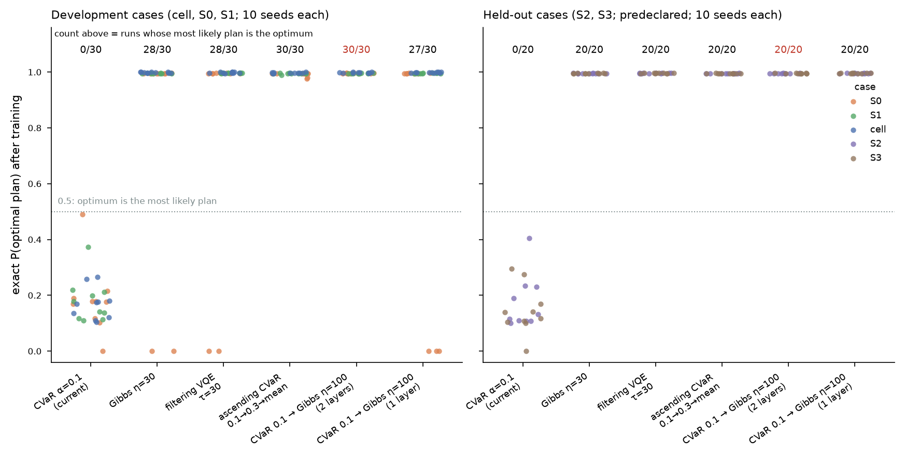
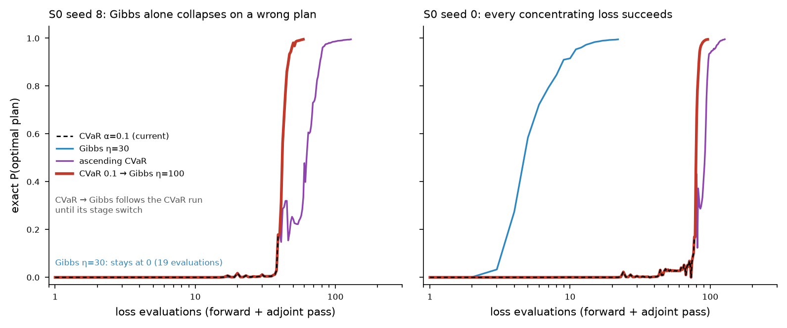
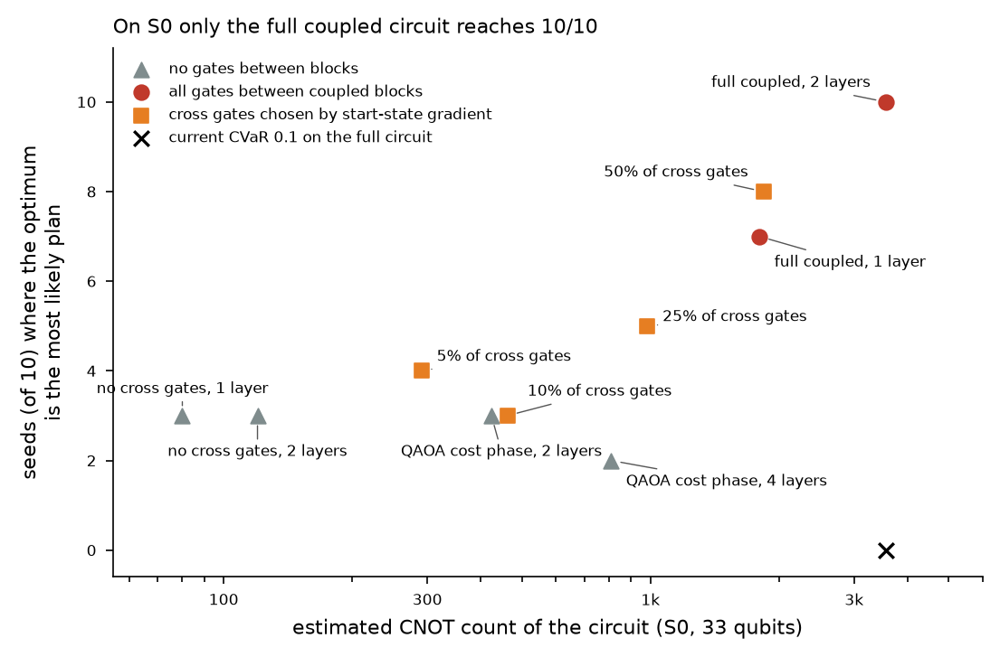

# Catering VQE, overnight study (18 Oct 2026): concentrating losses

**Question.** Can published VQE methods beat our current catering VQE (one-hot Givens circuit with controlled Givens between coupled blocks, 2 layers, exact CVaR α = 0.1, L-BFGS-B)?

**Answer.** Yes, in exact simulation. Train first with CVaR α = 0.1 (up to 150 loss evaluations), then switch to the Gibbs loss with η = 100 (up to 150 more). The circuit stays the same. The optimum then becomes the most likely plan in **30/30 development runs** and **20/20 predeclared held-out runs**, with P(optimum) ≈ 0.995. The current method reaches **0/50** on that measure (P(optimum) 0.12–0.18), although its 1,024 final samples contain the optimum in 49/50 runs. The cost is about 2× more loss evaluations.

**The limit.** With realistic shot noise (emulated) the advantage of the CVaR stage disappears. Plain Gibbs with Adam is then the best variant (S0: 8/10). Hardware cost is also prohibitive at these circuit sizes.

## Terms

- **P(optimum)**: probability that one measurement of the trained circuit returns the optimal plan (exact, from the simulated state).
- **"Optimum is the most likely plan"**: the most probable plan of the trained state is the optimum and has probability > 0.5. This is the primary metric here. It does not depend on luck in sampling.
- **"Optimum among 1,024 samples"**: the E5 primary metric. It is weak at these sizes. Untrained uniform sampling of the one-hot plans already includes the optimum with probability 0.4–1.6 % on S0–S3 and about 86 % on the cell (2 optima among 1,045 plans).
- **CVaR_α**: mean energy of the best fraction α of the probability. It stops improving once a fraction α sits on the optimum, which is why the current method ends near P(optimum) ≈ α.
- **Gibbs loss** (Li et al. 2020): −log Σ_x p(x) e^{−η E(x)}, with energies in units of w_U (one missed meal). It keeps rewarding more weight on the lowest energies, so it concentrates.
- **Ascending CVaR** (Kolotouros & Wallden 2022): α is raised during training (here 0.1 → 0.3 → 1).
- **Filtering VQE** (Amaro et al. 2022): each step fits the circuit to the filtered state e^{−τE}|ψ⟩.
- **Development / held-out**: methods were chosen on cell, S0 and S1 only. S2 and S3 were run once, after the predeclaration file was saved (written 01:11:39).

## 1. Literature (sub-agent review, 53 records checked against Crossref or arXiv)

See `vqe_literature_review.md` and `vqe_literature_table.csv`. The top-ranked methods and what we found:

| Published method | Published claim | Our reproduction (exact, coupled L = 2) |
|---|---|---|
| CVaR (Barkoutsos 2020) | better than mean energy; P(opt) saturates near α | our baseline: dev 0/30, held-out 0/20 most likely; P(opt) 0.12–0.18 |
| Ascending CVaR (Kolotouros & Wallden 2022) | Max-Cut success 96 % vs 84 % (α = 0.1) | dev **30/30**, held-out **20/20**; 62–128 evaluations |
| Gibbs loss (Li et al. 2020) | +9–11 % low-energy probability vs mean energy | dev 28/30 (fails S0 seeds 8, 9), held-out 20/20; ~20 evaluations |
| Filtering VQE (Amaro et al. 2022) | P(ground) 0.93 on 9 hardware qubits | dev 28/30, held-out 20/20; 33–69 evaluations |
| Adaptive gate selection (Grimsley 2019; Li 2020 AAS) | fewer two-qubit gates at equal quality | gradient selection at the start state: S0 3–8/10 when keeping 5–50 % of cross gates (section 3) |
| QAOA cost-phase / XY layers (Hadfield 2019; Wang 2020) | constraint-preserving mixers | block circuit + cost phase: S0 2–3/10 (section 3) |

Two claims in the review did not hold here. First, it suggests NFT/Rotosolve (one exact sinusoid per angle) for the Gibbs loss. That is false for our circuits: a Givens angle in the middle of the circuit enters p(x) with frequencies ½ and 1, as shown earlier with the four-term shift rule. Second, Li et al.'s η = 20 must be rescaled: with energies in w_U units, η between 10 and 300 all worked.

## 2. Hypotheses and verdicts

| # | Hypothesis | Test | Verdict |
|---|---|---|---|
| H1 | Losses that keep concentrating fix the P(opt) ≈ α ceiling | grid A: 12 losses, 3 dev cases, 5 seeds | **confirmed**: every concentrating loss reaches P(opt) ≈ 0.995 on seeds 0–4 |
| H2 | Gibbs alone is enough | seeds 5–9 (grids D, E) | **rejected on S0**: seeds 8 and 9 collapse onto a near-optimal plan (0.03 w_U above) within 20 evaluations |
| H3 | Explore first, then concentrate | CVaR 0.1 → Gibbs 100; ascending CVaR | **confirmed**: dev 30/30 for both; CVaR → Gibbs is cheaper (26–58 vs 62–128 evaluations) |
| H4 | The improvement transfers to unseen cases | predeclared S2/S3, 6 configurations × 10 seeds | **confirmed**: primary 10/10 and 10/10, P(opt) 0.995–0.996; baseline 0/10 and 0/10. The held-out cases are easier than S0 (gap 0.9 w_U vs 0.033), so every new loss also scored 20/20 there |
| H5 | With concentration, a cheaper circuit suffices | 1 layer; pruning to 5–50 % of cross gates; no cross gates; QAOA cost phase | **rejected on S0**: only the full coupled 2-layer circuit gets 10/10 (1 layer 7/10; best pruned 8/10; block-only 2–3/10). S1, the cell, S2 and S3 are solved even by the cheap circuits |
| H6 | A lower η or an η schedule avoids early collapse | η 3–300; Gibbs 3 → 30 → 300 | **rejected**: a schedule starting low is worse (S0 3/10) |
| H7 | Works with finite shots (1,024 per circuit) | SPSA; parameter-shift + Adam with emulated shot noise | **partly**: SPSA fails (S0 0/5, both losses). Parameter-shift Gibbs reaches S0 8/10 (fails seeds 8, 9, as in exact simulation). Staged CVaR → Gibbs fails (S0 1–2/5) because the noisy Adam CVaR stage never holds the optimum (P(opt) ~1e-4 at the switch); a longer stage, 4× more shots, a lower learning rate or a smaller η did not fix it |
| H8 | The start state matters | W start ± noise vs random angles | W + 0.2 rad is best; random angles cost Gibbs 1 seed in 5 and cut CVaR's sample success on S0 to 2/5 |

## 3. Results

| Set | Method | Most likely = optimum | Optimum among 1,024 samples | Median P(opt) | Median evaluations |
|---|---|---|---|---|---|
| dev | CVaR α=0.1 (current) | 0/30 | 30/30 | 0.176 | 11 |
| dev | Gibbs η=30 | 28/30 | 28/30 | 0.996 | 19 |
| dev | filtering VQE τ=30 | 28/30 | 28/30 | 0.996 | 54 |
| dev | ascending CVaR 0.1→0.3→mean | 30/30 | 30/30 | 0.995 | 83 |
| dev | CVaR 0.1 → Gibbs η=100 (2 layers) | 30/30 | 30/30 | 0.996 | 28 |
| dev | CVaR 0.1 → Gibbs η=100 (1 layer) | 27/30 | 27/30 | 0.996 | 23.5 |
| held-out | CVaR α=0.1 (current) | 0/20 | 19/20 | 0.124 | 20.5 |
| held-out | Gibbs η=30 | 20/20 | 20/20 | 0.995 | 21 |
| held-out | filtering VQE τ=30 | 20/20 | 20/20 | 0.996 | 62.5 |
| held-out | ascending CVaR 0.1→0.3→mean | 20/20 | 20/20 | 0.995 | 80 |
| held-out | CVaR 0.1 → Gibbs η=100 (2 layers) | 20/20 | 20/20 | 0.995 | 40 |
| held-out | CVaR 0.1 → Gibbs η=100 (1 layer) | 20/20 | 20/20 | 0.996 | 30.5 |

Contract-format results for the recommended new configuration (seed 0, `method-results/`, checked by `catering.run.evaluate`). The top sample is the optimum in every case:

| Case | P(opt) | Valid-sample rate | Top sample count (of 1,024) | Decoded (U, W, B, R) | Evaluations |
|---|---|---|---|---|---|
| cell | 0.9985 | 0.998 | 1018 | (0, 0, 2, 2) | 22 |
| S0 | 0.9951 | 0.993 | 1017 | (5, 0, 3, 3) | 96 |
| S1 | 0.9955 | 0.994 | 1018 | (7, 0, 1, 1) | 28 |
| S2 | 0.9956 | 0.996 | 1019 | (5, 4, 4, 4) | 52 |
| S3 | 0.9959 | 0.996 | 1020 | (6, 4, 4, 4) | 36 |

For comparison, the current method's contract results have valid-sample rates of 0.31–0.60 with the same decoded optima.

### Finite shots (S0, 33 qubits; emulated)

| Training | Most likely = optimum | Median P(opt) | Circuits per run |
|---|---|---|---|
| F5 SPSA cvar0.1 L2 | 0/5 | 8.05e-07 | 1,061 |
| F6 SPSA gibbs30 L2 | 0/5 | 1.3e-05 | 1,061 |
| F2 psAdam cvar>gibbs100 L2 | 2/5 | 1.93e-07 | 355,570 |
| F3 psAdam cvar>gibbs100 L1 | 1/5 | 3.33e-08 | 149,851 |
| F4 psAdam cvar>gibbs100 block-L1 | 0/5 | 8.54e-11 | 48,300 |
| F1 psAdam gibbs30 L2 | 5/5 | 0.783 | 530,700 |
| F1L psAdam gibbs30 L2 500it | 8/10 | 0.877 | 884,500 |
| S-a cvar200>gibbs100x200 | 2/5 | 1.93e-07 | 488,245 |
| S-b cvar100>gibbs30x200 | 1/5 | 2.57e-07 | 309,576 |
| S-c S4096 cvar100>gibbs100x200 | 1/5 | 1.28e-06 | 290,117 |
| S-d lr.02 cvar200>gibbs100x200 | 1/5 | 3.03e-08 | 592,616 |
| S-ref cvar100>gibbs100x200 | 2/5 | 1.93e-07 | 355,570 |

How the noise was modelled: the parameter-shift gradient is the exact adjoint gradient plus Gaussian noise with the variance of the four-term shift rule at 1,024 shots per shifted circuit, and loss values come from real samples. This is an emulation, not a circuit-by-circuit simulation. Gradient norms were clipped at 10³ when they would otherwise overflow (0–19 times per Gibbs run).

## 4. Caveats

1. **Small instances.** The one-hot sectors have 1,045–279,936 plans, so exhaustive enumeration is trivial and gives the reference optima. The comparison is between VQE training methods, not evidence of quantum advantage.
2. **Shot cost.** Gradient training of a 442-angle circuit needs about 1,800 circuits per step. A shot-based Gibbs run used about 885k circuits (≈ 9 × 10⁸ shots), far beyond a sensible hardware budget for a 140k-plan problem. SPSA is cheap (about 1k circuits) but fails.
3. **Held-out cases are easier than S0.** Their gap between optimum and runner-up is about 0.9 w_U, against 0.033 w_U in S0. The held-out set confirms the improvement over the baseline but does not separate the new losses from each other. That ranking comes from S0 (development), 10 seeds.
4. **CNOT counts are estimates**: 2 per Givens, 9 per controlled Givens (upper bound), 2 per cross-block coupler per cost-phase layer.
5. **Stopping rule**: training stops once one plan holds probability > 0.995, so P(opt) ≈ 0.995 is a ceiling set by that rule, not a limit of the method.
6. **Two bugs found and fixed in my shot emulator.** Both affected only the Gibbs gradient: the shift used for the Gibbs weights, and an overflow. The affected runs were rerun (grids F2, F3); the buggy results of grid F are not used.

## 5. Recommendation

- **Exact simulation (our contract runs):** use `RECOMMENDED_CONCENTRATED` (CVaR 0.1 for 150 evaluations, then Gibbs η = 100, total budget 300, same circuit). It keeps the current method's 1,024-sample success, makes the optimum the dominant plan in every tested run, and raises valid-sample rates from 31–60 % to above 99 %.
- **Any shot-based or hardware discussion:** say that the CVaR stage needs exact L-BFGS. With noisy Adam, plain Gibbs η = 30 is the better choice (S0 8/10), and the parameter-shift cost of these circuits is the bottleneck. Cheaper circuits only work on the easier cases.
